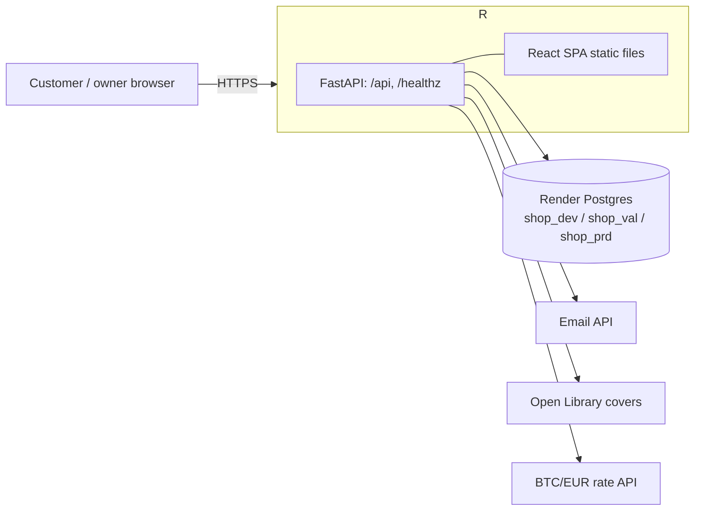

# Architecture

Owner: pro-architect. Decisions live in [docs/adr](adr/README.md).

## System shape

## Environments

| Env | URL | Render web | Database | Deploy |
|---|---|---|---|---|
| dev | dev.nygaardsvej41.dk | Free (sleeps) | shop_dev | auto on merge to main |
| val | val.nygaardsvej41.dk | Free (sleeps) | shop_val | manual dispatch |
| prd | nygaardsvej41.dk, www | Starter, always on | shop_prd | approval by chjort, tags `vN` |

Region Frankfurt, about $13/month. See [ADR 0001](adr/0001-hosting-and-environments.md).

## Pipeline

PR → lint, pytest, vitest, Docker build → merge → image `:sha` → dev (migrate, smoke) → val → prd (approval) → tag `vN` + release. See [ADR 0002](adr/0002-ci-cd-pipeline.md).

## Data model

To come in ADR 0003.

## API

To come in ADR 0004.
