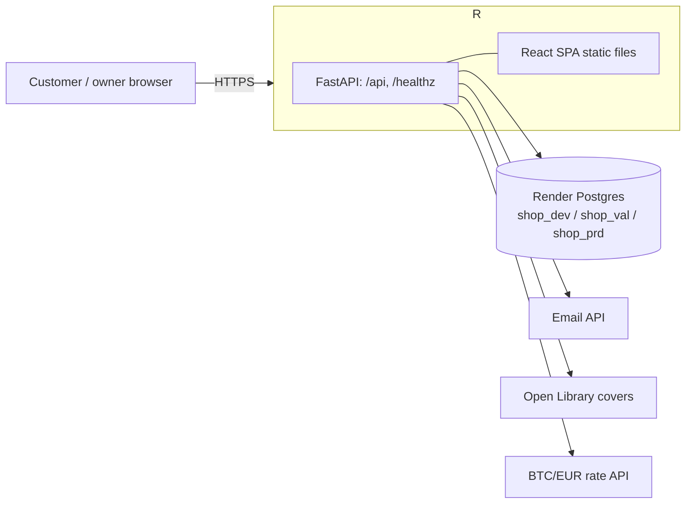

# Architecture

Owner: pro-architect. Decisions live in [docs/adr](adr/README.md).

## System shape

## Environments

| Env | URL | Render web | Database | Deploy |
|---|---|---|---|---|
| dev | dev.nygaardsvej41.dk | Free (sleeps) | shop_dev | auto on merge to main |
| val | val.nygaardsvej41.dk | Free (sleeps) | shop_val | manual dispatch |
| prd | nygaardsvej41.dk, www | Starter, always on | shop_prd | approval by chjort, tags `vN` |

Region Frankfurt, about $13/month. See [ADR 0001](adr/0001-hosting-and-environments.md).

## Pipeline

PR → lint, pytest, vitest, Docker build → merge → image `:sha` → dev (migrate, smoke) → val → prd (approval) → tag `vN` + release. See [ADR 0002](adr/0002-ci-cd-pipeline.md).

## Admin auth and CSV import

One owner, credentials from env vars (`ADMIN_USERNAME`, argon2 `ADMIN_PASSWORD_HASH`). Login sets a signed `HttpOnly`, `Secure`, `SameSite=Lax` session cookie (7 days, key `SESSION_SECRET`); every other `/api/admin/*` route returns 401 without it. Five failed logins lock the username for 15 min (`login_attempts` table), with the same generic message for 401 and 429. `POST /api/admin/import` (multipart, max 5 MB, UTF-8, comma or semicolon) validates each row (ISBN checksum, title, author, `price` > 0, whole `count` ≥ 0), skips bad and duplicate-ISBN rows with reasons in English, and upserts the rest by ISBN in one synchronous transaction. See [ADR 0003](adr/0003-admin-auth-and-csv-import.md).

## Cart, checkout and BTC amount

Cart lives in `localStorage`; the server rechecks prices and stock. `POST /api/orders` takes an `Idempotency-Key`, locks the books, reserves stock and stores the order in one transaction (409 `stock_changed`, 503 `rate_unavailable`). The BTC/EUR rate comes from Kraken with CoinGecko as fallback (60 s cache, must be under 5 min old) and is locked on the order. Money is integer cents and satoshis, rounded up, never recomputed. Orders get a short `BH-XXXXX` number for the wallet note and a secret HMAC-derived URL token (`/order/{token}`, stored only as a SHA-256 hash). Flat shipping is a setting; cancelling an unpaid order restores stock. See [ADR 0004](adr/0004-cart-checkout-and-btc-amount.md).

## Order emails

Paid and shipped emails go out through Brevo's HTTP API (proposal, needs the user's confirmation) from `orders@mail.nygaardsvej41.dk`. The status change commits first; the email is sent after commit and its result saved in `paid_email_status` / `shipped_email_status`. dev and val only send to `EMAIL_ALLOWLIST`. See [ADR 0005](adr/0005-order-emails.md).

## Browse and search

`GET /api/books?q=&genre=&page=` (24 per page), `GET /api/genres`, `GET /api/books/{id}`. Search matches a `search_text` column folded in Python at write time (å/aa, ø/oe, æ/ae, case, accents) with a `pg_trgm` GIN index. In-stock first, then title A–Z (Danish collation). See [ADR 0006](adr/0006-browse-and-search.md).

## Order handling

Admin list `GET /api/admin/orders?status=&q=&page=` (25 per page, counts per status) and detail by order number. `POST .../paid|ship|cancel` each run one conditional `UPDATE ... WHERE status = expected`; otherwise 409 `invalid_transition` with `current_status` and `status_changed_at`. Cancel restores stock in the same transaction. Expired session: 401, nothing applied. See [ADR 0007](adr/0007-order-handling.md).
