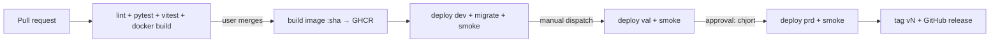

# ADR 0002: CI/CD pipeline

Status: Proposed · Author: pro-architect · Task: #2 (feature #1)

## Context

Trunk-based on GitHub, only the user merges, every PR must be green. dev, val and prd on Render (ADR 0001). Versions are plain integers; the prd commit is tagged `vN`.

## Options

- **GitHub Actions + Render deploy hooks** (chosen): no extra tools, environments with approvals built in.
- Render auto-deploy from git: no promotion control, rejected.
- External CI (CircleCI etc.): extra account for no gain, rejected.

## Decision

**On pull request** (`.github/workflows/ci.yml`), required status checks on `main`:
1. Lint: `ruff` (backend), `eslint` (frontend).
2. Backend tests: `pytest` against a Postgres service container.
3. Frontend tests: `vitest`.
4. Docker image build (multi-stage: build SPA, then Python runtime).

Branch protection on `main`: PR required, all checks green, no direct pushes.

**On merge to main** (`.github/workflows/deploy.yml`):
1. Build the image once, tag it with the commit SHA, push to GHCR (`ghcr.io/chjort/bookshop:<sha>`).
2. Deploy to **dev**: call the dev deploy hook with `?imgURL=` for that SHA.
3. Migrations: the image runs `alembic upgrade head` as the Render pre-deploy command, so a failed migration stops the deploy.
4. Smoke test: poll `https://dev.nygaardsvej41.dk/healthz` until it returns 200 with the expected SHA.

**Promote to val**: `workflow_dispatch` with input `sha`, job on GitHub environment `val`. Deploys the same image, then smoke tests.

**Promote to prd**: `workflow_dispatch` with input `sha`, job on GitHub environment `prd` with required reviewer **chjort**. Deploys the same image, smoke tests, then tags the commit with the next `vN` (highest existing `v*` + 1) and creates a GitHub release.

Render services have auto-deploy off; only the pipeline deploys. Deploy hook URLs are GitHub environment secrets `RENDER_DEPLOY_HOOK` in `dev`, `val`, `prd`. `/healthz` returns `{"status":"ok","version":"<sha>"}` and checks the database connection.

## Consequences

- One image goes through all envs, so val and prd run exactly what was tested.
- Migrations must be backward compatible with the previous release (expand, then contract), since the old version runs while the new one starts.
- Rollback: re-run the promote workflow with the previous SHA (schema changes need a forward fix).

## Fallback for private repo on GitHub Free

The repo is private and on GitHub Free. Per GitHub's docs (checked 2026-10-19), Free users can only configure environments on public repos, so private repos get no environments, environment secrets or required reviewers. Branch protection and rulesets are also not enforced on private repos on Free.

**Option A (recommended, if the user is fine with it): make the repo public.** Everything above works for free. Nothing secret is in git (ADR 0001), so the cost is only visibility of code and issues.

**Option B: stay private.**
- Deploy hooks are stored as repository secrets `RENDER_DEPLOY_HOOK_DEV`, `_VAL`, `_PRD` instead of environment secrets.
- val and prd promotions are `workflow_dispatch` only. The prd workflow requires a typed input `confirm_version` (e.g. `v1`) and fails unless it equals the next tag (highest `v*` + 1).
- Team rule: only the user triggers prd and merges PRs. All agents share the chjort account, so actor checks in the workflow cannot tell the user from an agent. This rule is enforced by convention, not by GitHub.
- CI still runs and shows its status on every PR. Merge discipline ("all checks green") is by convention too.

**Option C: GitHub Pro (~$4/mo).** Restores environments, required reviewers and branch protection on the private repo. Design as above.

## Manual setup (needs the user's own sign-in)

0. Choose Option A, B or C above (A or C: steps 1–3; B: step 2b only).
1. GitHub: create environments `dev`, `val`, `prd`; on `prd` add required reviewer chjort.
2. Copy each Render service's deploy hook URL into `RENDER_DEPLOY_HOOK` in the matching GitHub environment.
   2b. Option B: add them as repository secrets `RENDER_DEPLOY_HOOK_DEV`, `RENDER_DEPLOY_HOOK_VAL`, `RENDER_DEPLOY_HOOK_PRD` instead.
3. GitHub: enable branch protection on `main` with the CI checks required (once the CI workflow has run once).
4. If the GHCR package is private, add GHCR credentials as a registry credential in Render (or make the package public).
