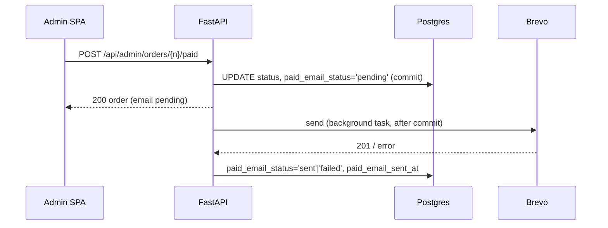

# ADR 0005: Order emails

Status: Proposed (provider choice needs the user's confirmation via pro-product-owner) · Author: pro-architect · Task: #31 (feature #30) · Design: #32 (emails), PR #53 (order handling)

## Context

The customer gets an email when the owner marks an order **paid** and again when it is marked **shipped** (RELEASE_PLAN.md, R1 feature 6). An "order received" email with payment instructions is Release 2, not R1. No email on cancel in R1 (PR #53, D3). Emails are in English (UI language changed on 2026-10-20; the "Danish" line on #30 is outdated) and include the order number.

Volume is tiny: a few orders a day, at most two emails per order. Constraints: EU data residency (Danish customers, GDPR), free or near-free, a plain HTTPS API (no SMTP connection from Render), and DKIM/SPF/DMARC on a subdomain of `nygaardsvej41.dk`, whose DNS is at one.com. No email provider has been picked yet.

## Options

Prices and limits checked on the providers' public pages on 2026-10-20.

| Provider | Free tier | First paid tier | Data location | API | Notes |
|---|---|---|---|---|---|
| **Brevo** (FR) | 300 emails/day, forever, no card | Starter from €7/month | EU (France, Germany) | `POST https://api.brevo.com/v3/smtp/email`, `api-key` header | Guided SPF/DKIM/DMARC setup; logs kept; EU company |
| Mailjet (Sinch, FR) | 6,000/month, 200/day, no card | $9/month, 8,000 | EU (6 data centres in Europe) | `POST /v3.1/send`, basic auth | Also fine; free emails carry a Mailjet logo in marketing, and API is a little clunkier |
| Postmark (US) | 100/month | $15/month, 10,000 | US only | Simple JSON API | Best deliverability, but no EU hosting and the free tier is too small for prd |
| Resend (US) | 3,000/month, 100/day | $20/month, 50,000 | Sends from EU region, account data stored in the US | Simplest API | Data not EU-resident |
| Amazon SES | No lasting free tier; about $0.10 per 1,000 | Pay per use | EU region (eu-central-1 Frankfurt) | AWS SigV4 API | Cheapest at scale, but needs an AWS account, IAM setup and a manual request to leave the sandbox. Too much setup for this shop |

## Decision

### Provider (proposal)

**Brevo, free plan.** It's an EU company with data in France and Germany, free forever at 300 emails/day (about 150 orders a day, far above expected volume), and sending is one JSON POST with an API key. Cost: **€0/month**. If the shop outgrows it, Starter is from €7/month. Mailjet is the fallback with the same design; only the sender adapter changes.

This needs the user's go-ahead, through pro-product-owner, before anyone creates the account. Creating the Brevo account and adding the DNS records at one.com both need the user's own sign-in.

### Sending domain

- Sender subdomain `mail.nygaardsvej41.dk`, so the main domain's mail setup is untouched.
- From: `probooks <orders@mail.nygaardsvej41.dk>` (`EMAIL_FROM`). Reply-To: the owner's own address (`EMAIL_REPLY_TO`), so customer replies reach a real inbox. Nothing receives mail at `mail.` itself.
- DNS at one.com (exact values come from Brevo's domain page):
  - Brevo verification TXT on `mail.nygaardsvej41.dk`.
  - DKIM record(s) from Brevo for `mail.nygaardsvej41.dk`.
  - SPF: `mail.nygaardsvej41.dk TXT "v=spf1 include:spf.brevo.com ~all"`.
  - DMARC: `_dmarc.mail.nygaardsvej41.dk TXT "v=DMARC1; p=none; rua=mailto:<owner address>"`. Move to `p=quarantine` after a few weeks of clean reports.

### When and how emails are sent



- The status change commits first, in its own transaction, with `<step>_email_status = 'pending'`. The email is sent **after** the commit, in a FastAPI `BackgroundTask` (runs after the response, same process; no queue or worker).
- One attempt with a 10 s timeout and one retry after 2 s on a network error or 5xx. A 4xx is not retried.
- Then a second short transaction sets `<step>_email_status` to `sent` (and `<step>_email_sent_at = now()`) or `failed`. A failed email never rolls back the status change.
- If the process dies between commit and send, the status stays `pending`. The admin UI shows `pending` older than 5 minutes the same way as `failed`.
- Logs record order number, step, result and the provider message id. No email bodies or addresses in logs.

### Data model

New columns on `orders` (migration in this feature):

```sql
CREATE TYPE email_status AS ENUM ('pending', 'sent', 'failed');
ALTER TABLE orders
  ADD COLUMN paid_email_status     email_status,   -- NULL until the order is marked paid
  ADD COLUMN paid_email_sent_at    timestamptz,
  ADD COLUMN shipped_email_status  email_status,   -- NULL until the order is marked shipped
  ADD COLUMN shipped_email_sent_at timestamptz;
```

`NULL` means "no email due yet", shown as "not yet" in the UI (PR #53, 3.4).

### Resend

- `POST /api/admin/orders/{order_number}/emails/{step}/resend`, `step` is `paid` or `shipped`. Admin only (401 without a session, nothing sent).
- Allowed when the order has reached that step and its email status is `failed` or `pending`. Sets `pending`, commits, and sends as above. Returns 409 `{"code": "email_already_sent"}` if it's `sent`, 409 `{"code": "email_not_due"}` if the step wasn't reached.
- The UI has no resend button in R1 (PR #53, D1). The endpoint exists for later and for QA.

### dev and val

- `APP_ENV` decides. In `prd` every customer gets their email.
- In `dev` and `val`, mail goes only to addresses in `EMAIL_ALLOWLIST` (comma-separated; an entry starting with `@` allows a whole domain, e.g. `@example.dk`). Other recipients are **not sent**. The log notes "suppressed: not in allowlist" and the status is set to `sent`, so the UI behaves as in prd.
- If `EMAIL_API_KEY` is empty (local and CI), a log-only sender is used. Tests use a fake sender and never call Brevo.
- One Brevo account and key for all environments. The subject gets a prefix in dev and val (`[dev]`, `[val]`).

### Configuration

| Env var | Example | Notes |
|---|---|---|
| `EMAIL_API_KEY` | Brevo v3 key | Secret, per Render service (already listed in ADR 0001) |
| `EMAIL_FROM` | `probooks <orders@mail.nygaardsvej41.dk>` | |
| `EMAIL_REPLY_TO` | owner's address | |
| `EMAIL_ALLOWLIST` | `chjort@…,@example.dk` | dev and val only |

### Templates

- Jinja2 templates in `backend/app/emails/`: `paid.txt`, `paid.html`, `shipped.txt`, `shipped.html`. Every email is sent as multipart with both a plain-text and an HTML part.
- The HTML is simple: one column, system fonts, no images, no tracking pixels, no external CSS. Brevo open and click tracking is turned off.
- English. Each email includes the shop name, the order number, the items with quantities, the total in EUR, the delivery address and the Reply-To contact. The exact text comes from the design task #32.
- Subjects: `Payment received for order BH-7K3Q9` and `Your order BH-7K3Q9 has shipped`.

### Sender interface

```python
class EmailSender(Protocol):
    def send(self, to: str, subject: str, text: str, html: str) -> str: ...  # returns provider message id, raises EmailError
```

Implementations: `BrevoSender` (httpx), `LogSender`, `FakeSender` (tests). Switching provider means adding one class.

## Consequences

- No queue or worker. A crash right after a status change can leave an email `pending`; the admin sees that and can resend.
- The email can be a few seconds behind the status change. The admin UI shows `pending` until it's done.
- €0/month at this volume; the 300/day cap is far above need. If it's ever hit, Brevo holds up to 1,000 extra transactional emails for the next day.
- Customer email addresses and names pass to Brevo (EU). The privacy policy page (R2) must list Brevo as a processor; Brevo's standard DPA covers it.
- The user must create the Brevo account and add the one.com DNS records with their own sign-in.
