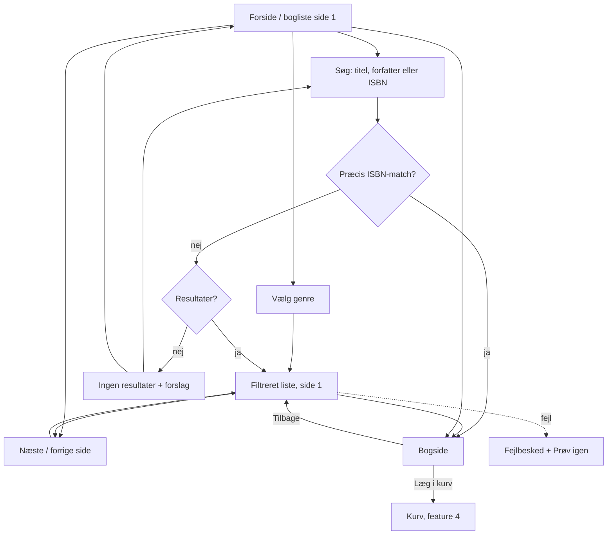

# Design: browse and search

Feature: #12 · Task: #14 · Release 1 (walking skeleton) · Author: pro-designer

## 1. Purpose

Customers find books by browsing genres or searching by title, author or ISBN, then open a book page with cover, price and stock status. The UI is in Danish. The API, page size, search technique and cover fetching follow pro-architect's contract; this spec only defines what the customer sees.

## 2. User flow



Filter, search and page live in the URL (`?genre=krimi&q=hansen&side=3`), so Back, reload and shared links restore the same view. Changing search or genre resets to page 1. Search and genre combine (search within a genre). Default sort is title A–Å with out-of-stock books last; no sort control in R1.

## 3. Wireframes

### 3.1 Catalogue list: desktop (≥ 960 px)

```
+--------------------------------------------------------------------------+
| Boghandel            [ Søg efter titel, forfatter eller ISBN  ][Søg]  Kurv (2) |
+--------------------------------------------------------------------------+
| Genrer          | Alle bøger                          1.243 bøger        |
| (•) Alle  1.243 |                                                         |
| ( ) Fantasy 212 | +--------+ +--------+ +--------+ +--------+            |
| ( ) Krimi   318 | | cover  | | cover  | | cover  | | cover  |            |
| ( ) Romaner 401 | |        | |        | |        | |        |            |
| ( ) Øvrige   37 | +--------+ +--------+ +--------+ +--------+            |
|  …              | Titel på   Meget lang  Titel     Titel                  |
|                 | to linjer… titel der…                                   |
|                 | Forfatter  Forfatter   Forfatter Forfatter              |
|                 | 12,50 €    8,00 €      19,95 €   14,00 €                |
|                 | På lager   På lager    På lager  Udsolgt                |
|                 |                                                         |
|                 |  … (grid; page size per contract; Udsolgt last)         |
|                 |                                                         |
|                 |   [‹ Forrige]  1  2  [3]  4  5 … 52  [Næste ›]          |
+--------------------------------------------------------------------------+
```

### 3.2 Catalogue list: mobile (< 600 px)

```
+------------------------------+
| Boghandel        Kurv (2)    |
| [ Søg titel, forfatter, ISBN ][⌕] |
| Genre: [ Alle genrer     ▾ ] |
| 1.243 bøger                  |
+------------------------------+
| +-----+ +-----+              |
| |cover| |cover|              |   2-column grid
| +-----+ +-----+              |
| Titel…  Titel…               |
| Forf.   Forf.                |
| 12,50 € 8,00 €               |
| På lager På lager            |
|  …                           |
| [‹ Forrige] Side 3 af 52 [Næste ›] |
+------------------------------+
```

Tablet (600–959 px): genre as the dropdown, 3-column grid. Desktop: genre sidebar, 4-column grid.

### 3.3 Genre filter

Desktop: a radio-button list in the sidebar inside a `<fieldset>` with legend "Genrer", sorted A–Å, "Øvrige" last, each with its count. Mobile: a native `<select>` labelled "Genre". Selecting applies immediately (no extra button) and resets to page 1. The list heading changes to the genre name.

### 3.4 Search with results

```
| Søgeresultater for "hansen" i Krimi        14 bøger   [× Ryd søgning] |
| +--------+ +--------+ ...                                             |
```

Search submits on Enter or the Søg button (no live search for Release 1). An exact ISBN match (with or without hyphens) goes straight to the book page. Partial ISBNs search normally.

### 3.5 Empty search result

```
+--------------------------------------------------------------+
|  Ingen bøger matcher "xqzv".                                 |
|                                                              |
|  Prøv at:                                                    |
|  • tjekke stavningen                                         |
|  • søge på færre ord eller kun forfatterens efternavn        |
|  • søge i alle genrer   [Søg i alle genrer]  (if a genre is active) |
|                                                              |
|  [Se alle bøger]                                             |
+--------------------------------------------------------------+
```

### 3.6 Book detail (`/bog/{isbn}`)

```
Desktop                                          Mobile
+-------------------------------------------+    +----------------------+
| ‹ Tilbage til søgningen                   |    | ‹ Tilbage            |
| +------------+  Titel på bogen, også hvis |    | +------------------+ |
| |            |  den er meget lang         |    | |      cover       | |
| |   cover    |  af Forfatter Navn         |    | +------------------+ |
| |   2:3      |                            |    | Titel på bogen       |
| |            |  12,50 €                   |    | af Forfatter         |
| +------------+  På lager                  |    | 12,50 €              |
|                 [ Læg i kurv ]            |    | På lager             |
|                 Genre: Krimi              |    | [ Læg i kurv ]       |
|                 ISBN: 978-87-02-01111-1   |    | Genre: Krimi         |
|                 Fragt: fast pris i DK     |    | ISBN: 978-…          |
+-------------------------------------------+    +----------------------+
```

"Læg i kurv" belongs to feature 4; in this feature it may be absent or disabled. Out of stock: no add-to-cart button; the badge "Udsolgt" and the text "Kan ikke lægges i kurven" show instead.

### 3.7 Placeholder cover

```
+------------+
|            |
|   [book]   |     neutral grey #E8E6E1 background, simple book icon,
|            |     title (max 3 lines) in #3A3A3A, 2:3 ratio
|  Titel på  |
|  bogen     |
+------------+
```

Same 2:3 box as real covers so the grid doesn't jump. Shown when Open Library has no image, while the image loads (as the skeleton), and when it fails to load. No broken-image icons.

## 4. Price and stock display

- Price: Danish format, `12,50 €` (comma decimal, dot thousands, space before €, two decimals): `1.250,00 €`. Use `Intl.NumberFormat('da-DK', {style:'currency', currency:'EUR'})`.
- Stock badge shows available = stock − reserved (reserved stock is held by unpaid orders; RELEASE_PLAN.md). Customers never see the reserved count.

| Available | Badge (text + icon, not colour alone) |
|---|---|
| ≥ 1 | ✓ På lager |
| 0 (incl. all reserved) | – Udsolgt |

No low-stock badge in R1. Out-of-stock books stay in the list, sort last, are marked "Udsolgt" and can't be added to the cart. Their covers are greyed at 60 % opacity, with the badge kept at full contrast. Fuller out-of-stock handling is R2 (#40).

## 5. States

| State | What the customer sees |
|---|---|
| Loading list | Skeleton grid: grey cover boxes and two text bars per card, same count as page size. Count text "Henter bøger …" for screen readers. |
| Loading book page | Skeleton of cover and three text bars. |
| Cover loading | Placeholder cover until the image arrives; fade in. |
| Error (list) | "Vi kunne ikke hente bøgerne. Prøv igen om lidt." [Prøv igen] |
| Error (book) | Not found: "Bogen findes ikke længere." [Se alle bøger]. Other: same text as list error. |
| No results (search) | Section 3.5. |
| No results (genre empty) | "Der er ingen bøger i denne genre lige nu." [Se alle bøger] |
| Empty catalogue | "Butikken er ved at blive fyldt op. Kig forbi igen snart." |
| ISBN search, exact match | Go straight to the book page (no list in between). |
| Page out of range (`?side=999`) | Show the last page, or an error with [Gå til første side]. |

## 6. Edge cases

| Case | Handling |
|---|---|
| Thousands of titles | Server-side paging, filtering and sorting (title A–Å, Udsolgt last); page size per pro-architect's contract. Pagination shows first, last and ±2 around current with "…". |
| Very long titles / authors | Cards: clamp title to 2 lines and author to 1 with ellipsis; full text in the book page and in the accessible name. Long unbroken words wrap (`overflow-wrap: anywhere`). |
| ISBN search | Accept ISBN-10/13 with or without hyphens or spaces (`978-87-…`, `97887…`). An exact match opens the book page directly. Show the ISBN hyphenated on the book page if the contract provides it. |
| Danish letters æøå | Search must match `æ ø å` as typed and case-insensitively (`Ærø` = `ærø`). Search folds `aa`→`å`, `oe`→`ø`, `ae`→`æ` and ignores case and accents (`Aarhus` finds `Århus`, `Moeller` finds `Møller`, `Jose` finds `José`). Sorting uses Danish collation (Æ, Ø, Å after Z). URLs encode the query. |
| Empty genre | Shown as "Øvrige" in filter, cards and book page; listed last in the filter. |
| Missing author | Show nothing instead of "af ". |
| Whitespace-only search | Treated as no search; shows all books. |
| Very long query | Input max 200 characters. |
| Cover image is huge or slow | Fixed 2:3 box, lazy loading below the fold. |

## 7. Danish copy

| Key | Danish |
|---|---|
| Shop name | Boghandel (placeholder until the user names the shop) |
| Search label (visually hidden) | Søg i bøger |
| Search placeholder | Søg efter titel, forfatter eller ISBN |
| Search button | Søg |
| Clear search | Ryd søgning |
| Genre legend / select label | Genrer / Genre |
| All genres | Alle / Alle genrer |
| Empty genre | Øvrige |
| List heading | Alle bøger / {genre} / Søgeresultater for "{q}" / Søgeresultater for "{q}" i {genre} |
| Count | {n} bøger · 1 bog |
| Author prefix | af {forfatter} |
| Stock | På lager · Udsolgt · Kan ikke lægges i kurven |
| Pagination | ‹ Forrige · Næste › · Side {a} af {b} · Gå til side {n} |
| Pagination nav label | Sider |
| Loading | Henter bøger … |
| No results | Ingen bøger matcher "{q}". |
| No results tips | Prøv at: · tjekke stavningen · søge på færre ord eller kun forfatterens efternavn · søge i alle genrer |
| Buttons | Søg i alle genrer · Se alle bøger · Prøv igen · Gå til første side |
| Empty genre list | Der er ingen bøger i denne genre lige nu. |
| Empty catalogue | Butikken er ved at blive fyldt op. Kig forbi igen snart. |
| Error | Vi kunne ikke hente bøgerne. Prøv igen om lidt. |
| Book not found | Bogen findes ikke længere. |
| Back | ‹ Tilbage til søgningen · ‹ Tilbage |
| Detail labels | Genre: · ISBN: · Fragt: fast pris i Danmark |
| Add to cart (feature 4) | Læg i kurv |
| Cart | Kurv ({n}) |
| Cover alt | Forside af {titel} |
| Results announcement | {n} bøger fundet. Side {a} af {b}. |

## 8. Accessibility (WCAG 2.1 AA)

- `lang="da"`. Landmarks: `<header>`, `<search>` (or `<form role="search">`) with a label "Søg i bøger", `<nav aria-label="Genrer">` on desktop, `<main>`, `<nav aria-label="Sider">` for pagination.
- Search input has a real `<label>` (visually hidden), `type="search"`.
- Results announced: an `aria-live="polite"` region updates with "{n} bøger fundet. Side {a} af {b}." after search, filter or page change; "Ingen bøger matcher …" for none. Loading is announced as "Henter bøger …".
- After a page change, focus moves to the list heading (`tabindex="-1"`) so keyboard users don't land at the footer; the page title updates ("Krimi – side 3 – Boghandel").
- Pagination: real links (`<a href="?side=3">`), current page has `aria-current="page"`, Forrige/Næste are hidden (not just disabled) at the ends or have `aria-disabled`. Each number has an accessible name "Gå til side {n}". Hit targets at least 24×24 px (44 px on mobile).
- Genre filter: radio group in a fieldset with a legend; arrow keys move between options. Mobile native select.
- Cards: one link per card covering the title, with the card's accessible name being the full title; cover image inside the link has `alt=""` to avoid repetition. On the book page the cover has `alt="Forside af {titel}"`; the placeholder cover is decorative (`alt=""`) because the title is right next to it.
- Stock is conveyed by text, not colour. Text contrast ≥ 4.5:1, badges and focus rings ≥ 3:1; greyed out-of-stock covers keep text at full contrast.
- Skeletons have `aria-hidden="true"`; the live region carries the loading text. Respect `prefers-reduced-motion` (no shimmer).
- Reflow at 320 px and 200 % zoom without horizontal scroll.

## 9. Acceptance criteria mapping (#12)

| Acceptance criterion | Spec sections |
|---|---|
| The book list is paged and loads quickly with thousands of titles. | 3.1, 3.2, 5 (loading skeleton), 6 (thousands of titles), 8 (pagination), 10.6–10.7 |
| Customers can filter by genre. | 2, 3.3, 5 (empty genre), 6 (Øvrige), 7 |
| Customers can search by title, author or ISBN. | 2, 3.4, 3.5, 5 (exact ISBN), 6 (ISBN, æøå folding, whitespace), 7, 8, 10.2–10.3 |
| A book page shows the cover (from Open Library or a placeholder), price in EUR and whether it is in stock. | 3.6, 3.7, 4 (På lager / Udsolgt), 5 (book loading/error), 8 (alt text), 10.4–10.5 |

## 10. Resolved decisions

Answered by pro-product-owner.

1. **Shop name:** "Boghandel" stays as a placeholder until the user names the shop.
2. **Exact ISBN match:** goes straight to the book page.
3. **Search folding:** `aa`→`å`, `oe`→`ø`, `ae`→`æ`; case and accents ignored.
4. **Stock badge:** no low-stock badge in R1, only "På lager" or "Udsolgt".
5. **Out of stock:** stays visible, sorts last, is marked "Udsolgt" and can't be added to the cart. Fuller handling in R2 (#40).
6. **Sort:** title A–Å by default; no sort control in R1.
7. **Page size and URLs:** follow pro-architect's contract. `/bog/{isbn}` and `?genre=&q=&side=` in this spec are illustrative.
8. **Book descriptions:** not in R1.

## 11. Later ideas

- Book descriptions (e.g. from Open Library) on the book page.
- Low-stock badge and sort control.
