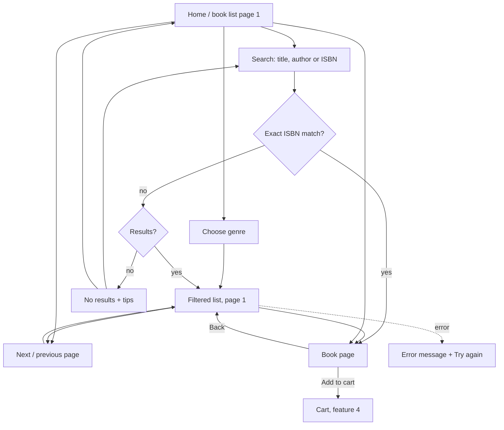

# Design: browse and search

Feature: #12 · Task: #14 · Release 1 (walking skeleton) · Author: pro-designer

## 1. Purpose

Customers find books by browsing genres or searching by title, author or ISBN, then open a book page with cover, price and stock status. The UI is in English only. The API, page size, search technique and cover fetching follow pro-architect's contract; this spec only defines what the customer sees.

## 2. User flow



Filter, search and page live in the URL (`?genre=crime&q=hansen&page=3`), so Back, reload and shared links restore the same view. Changing search or genre resets to page 1. Search and genre combine (search within a genre). Default sort is title A–Z (æ, ø, å sort after z) with out-of-stock books last; no sort control in R1.

## 3. Wireframes

### 3.1 Catalogue list: desktop (≥ 960 px)

```
+--------------------------------------------------------------------------+
| probooks             [ Search by title, author or ISBN    ][Search]  Cart (2) |
+--------------------------------------------------------------------------+
| Genres          | All books                           1,243 books        |
| (•) All   1,243 |                                                         |
| ( ) Fantasy 212 | +--------+ +--------+ +--------+ +--------+            |
| ( ) Krimi   318 | | cover  | | cover  | | cover  | | cover  |            |
| ( ) Romaner 401 | |        | |        | |        | |        |            |
| ( ) Other    37 | +--------+ +--------+ +--------+ +--------+            |
|  …              | Title on   A very long Title     Title                  |
|                 | two lines… title that…                                  |
|                 | Author     Author      Author    Author                 |
|                 | €12.50     €8.00       €19.95    €14.00                 |
|                 | In stock   In stock    In stock  Sold out               |
|                 |                                                         |
|                 |  … (grid; page size per contract; Sold out last)        |
|                 |                                                         |
|                 |   [‹ Previous]  1  2  [3]  4  5 … 52  [Next ›]          |
+--------------------------------------------------------------------------+
```

Genre names come from the owner's CSV and are shown as written (content, not UI copy).

### 3.2 Catalogue list: mobile (< 600 px)

```
+------------------------------+
| probooks         Cart (2)    |
| [ Search title, author, ISBN ][⌕] |
| Genre: [ All genres      ▾ ] |
| 1,243 books                  |
+------------------------------+
| +-----+ +-----+              |
| |cover| |cover|              |   2-column grid
| +-----+ +-----+              |
| Title…  Title…               |
| Author  Author               |
| €12.50  €8.00                |
| In stock In stock            |
|  …                           |
| [‹ Previous] Page 3 of 52 [Next ›] |
+------------------------------+
```

Tablet (600–959 px): genre as the dropdown, 3-column grid. Desktop: genre sidebar, 4-column grid.

### 3.3 Genre filter

Desktop: a radio-button list in the sidebar inside a `<fieldset>` with legend "Genres", sorted A–Z (æ, ø, å after z), "Other" last, each with its count. Mobile: a native `<select>` labelled "Genre". Selecting applies immediately (no extra button) and resets to page 1. The list heading changes to the genre name.

### 3.4 Search with results

```
| Search results for "hansen" in Krimi       14 books   [× Clear search] |
| +--------+ +--------+ ...                                             |
```

Search submits on Enter or the Search button (no live search for Release 1). An exact ISBN match (with or without hyphens) goes straight to the book page. Partial ISBNs search normally.

### 3.5 Empty search result

```
+--------------------------------------------------------------+
|  No books match "xqzv".                                      |
|                                                              |
|  Try:                                                        |
|  • checking the spelling                                     |
|  • using fewer words, or just the author's last name         |
|  • searching all genres   [Search all genres]  (if a genre is active) |
|                                                              |
|  [See all books]                                             |
+--------------------------------------------------------------+
```

### 3.6 Book detail (`/book/{isbn}`)

```
Desktop                                          Mobile
+-------------------------------------------+    +----------------------+
| ‹ Back to search                          |    | ‹ Back               |
| +------------+  Book title, even if it is |    | +------------------+ |
| |            |  very long                 |    | |      cover       | |
| |   cover    |  by Author Name            |    | +------------------+ |
| |   2:3      |                            |    | Book title           |
| |            |  €12.50                    |    | by Author            |
| +------------+  In stock                  |    | €12.50               |
|                 [ Add to cart ]           |    | In stock             |
|                 Genre: Krimi              |    | [ Add to cart ]      |
|                 ISBN: 978-87-02-01111-1   |    | Genre: Krimi         |
|                 Shipping: flat €3.00 (Denmark) | | ISBN: 978-…          |
+-------------------------------------------+    +----------------------+
```

"Add to cart" belongs to feature 4; in this feature it may be absent or disabled. Out of stock: no add-to-cart button; the badge "Sold out" and the text "Can't be added to the cart" show instead.

### 3.7 Placeholder cover

```
+------------+
|            |
|   [book]   |     neutral grey #E8E6E1 background, simple book icon,
|            |     title (max 3 lines) in #3A3A3A, 2:3 ratio
|  Book      |
|  title     |
+------------+
```

Same 2:3 box as real covers so the grid doesn't jump. Shown when Open Library has no image, while the image loads (as the skeleton), and when it fails to load. No broken-image icons.

## 4. Price and stock display

- Price: English format, `€12.50` (euro sign first, no space, dot decimal, comma thousands, two decimals): `€1,250.00`. Use `Intl.NumberFormat('en-IE', {style:'currency', currency:'EUR'})`.
- Stock badge shows available = stock − reserved (reserved stock is held by unpaid orders; RELEASE_PLAN.md). Customers never see the reserved count.

| Available | Badge (text + icon, not colour alone) |
|---|---|
| ≥ 1 | ✓ In stock |
| 0 (incl. all reserved) | – Sold out |

No low-stock badge in R1. Out-of-stock books stay in the list, sort last, are marked "Sold out" and can't be added to the cart. Their covers are greyed at 60 % opacity, with the badge kept at full contrast. Fuller out-of-stock handling is R2 (#40).

## 5. States

| State | What the customer sees |
|---|---|
| Loading list | Skeleton grid: grey cover boxes and two text bars per card, same count as page size. Count text "Loading books …" for screen readers. |
| Loading book page | Skeleton of cover and three text bars. |
| Cover loading | Placeholder cover until the image arrives; fade in. |
| Error (list) | "We couldn't load the books. Please try again in a moment." [Try again] |
| Error (book) | Not found: "This book is no longer available." [See all books]. Other: same text as list error. |
| No results (search) | Section 3.5. |
| No results (genre empty) | "There are no books in this genre right now." [See all books] |
| Empty catalogue | "The shop is being stocked. Check back soon." |
| ISBN search, exact match | Go straight to the book page (no list in between). |
| Page out of range (`?page=999`) | Show the last page, or an error with [Go to first page]. |

## 6. Edge cases

| Case | Handling |
|---|---|
| Thousands of titles | Server-side paging, filtering and sorting (title A–Z, Sold out last); page size per pro-architect's contract. Pagination shows first, last and ±2 around current with "…". |
| Very long titles / authors | Cards: clamp title to 2 lines and author to 1 with ellipsis; full text in the book page and in the accessible name. Long unbroken words wrap (`overflow-wrap: anywhere`). |
| ISBN search | Accept ISBN-10/13 with or without hyphens or spaces (`978-87-…`, `97887…`). An exact match opens the book page directly. Show the ISBN hyphenated on the book page if the contract provides it. |
| Danish letters æøå in titles and authors | The UI is English, but many titles and authors are Danish. Search must match `æ ø å` as typed and case-insensitively (`Ærø` = `ærø`). Search folds `aa`→`å`, `oe`→`ø`, `ae`→`æ` and ignores case and accents (`Aarhus` finds `Århus`, `Moeller` finds `Møller`, `Jose` finds `José`). Sorting is A–Z with Danish collation, so Æ, Ø, Å sort after Z. URLs encode the query. |
| Empty genre | Shown as "Other" in filter, cards and book page; listed last in the filter. |
| Missing author | Show nothing instead of "by ". |
| Whitespace-only search | Treated as no search; shows all books. |
| Very long query | Input max 100 characters (ADR 0006). |
| Cover image is huge or slow | Fixed 2:3 box, lazy loading below the fold. |

## 7. UI copy

| Key | English |
|---|---|
| Shop name | probooks |
| Search label (visually hidden) | Search books |
| Search placeholder | Search by title, author or ISBN |
| Search button | Search |
| Clear search | Clear search |
| Genre legend / select label | Genres / Genre |
| All genres | All / All genres |
| Empty genre | Other |
| List heading | All books / {genre} / Search results for "{q}" / Search results for "{q}" in {genre} |
| Count | {n} books · 1 book |
| Author prefix | by {author} |
| Stock | In stock · Sold out · Can't be added to the cart |
| Pagination | ‹ Previous · Next › · Page {a} of {b} · Go to page {n} |
| Pagination nav label | Pages |
| Loading | Loading books … |
| No results | No books match "{q}". |
| No results tips | Try: · checking the spelling · using fewer words, or just the author's last name · searching all genres |
| Buttons | Search all genres · See all books · Try again · Go to first page |
| Empty genre list | There are no books in this genre right now. |
| Empty catalogue | The shop is being stocked. Check back soon. |
| Error | We couldn't load the books. Please try again in a moment. |
| Book not found | This book is no longer available. |
| Back | ‹ Back to search · ‹ Back |
| Detail labels | Genre: · ISBN: · Shipping: flat €3.00 (Denmark only) |
| Add to cart (feature 4) | Add to cart |
| Cart | Cart ({n}) |
| Cover alt | Cover of {title} |
| Results announcement | {n} books found. Page {a} of {b}. |

## 8. Accessibility (WCAG 2.1 AA)

- `lang="en"`. Landmarks: `<header>`, `<search>` (or `<form role="search">`) with a label "Search books", `<nav aria-label="Genres">` on desktop, `<main>`, `<nav aria-label="Pages">` for pagination. Danish titles stay in the English page; no per-title `lang` needed for R1.
- Search input has a real `<label>` (visually hidden), `type="search"`.
- Results announced: an `aria-live="polite"` region updates with "{n} books found. Page {a} of {b}." after search, filter or page change; "No books match …" for none. Loading is announced as "Loading books …".
- After a page change, focus moves to the list heading (`tabindex="-1"`) so keyboard users don't land at the footer; the page title updates ("Krimi – page 3 – probooks").
- Pagination: real links (`<a href="?page=3">`), current page has `aria-current="page"`, Previous/Next are hidden (not just disabled) at the ends or have `aria-disabled`. Each number has an accessible name "Go to page {n}". Hit targets at least 24×24 px (44 px on mobile).
- Genre filter: radio group in a fieldset with a legend; arrow keys move between options. Mobile native select.
- Cards: one link per card covering the title, with the card's accessible name being the full title; cover image inside the link has `alt=""` to avoid repetition. On the book page the cover has `alt="Cover of {title}"`; the placeholder cover is decorative (`alt=""`) because the title is right next to it.
- Stock is conveyed by text, not colour. Text contrast ≥ 4.5:1, badges and focus rings ≥ 3:1; greyed out-of-stock covers keep text at full contrast.
- Skeletons have `aria-hidden="true"`; the live region carries the loading text. Respect `prefers-reduced-motion` (no shimmer).
- Reflow at 320 px and 200 % zoom without horizontal scroll.

## 9. Acceptance criteria mapping (#12)

| Acceptance criterion | Spec sections |
|---|---|
| The book list is paged and loads quickly with thousands of titles. | 3.1, 3.2, 5 (loading skeleton), 6 (thousands of titles), 8 (pagination), 10.6–10.7 |
| Customers can filter by genre. | 2, 3.3, 5 (empty genre), 6 (Other), 7 |
| Customers can search by title, author or ISBN. | 2, 3.4, 3.5, 5 (exact ISBN), 6 (ISBN, æøå folding, whitespace), 7, 8, 10.2–10.3 |
| A book page shows the cover (from Open Library or a placeholder), price in EUR and whether it is in stock. | 3.6, 3.7, 4 (In stock / Sold out), 5 (book loading/error), 8 (alt text), 10.4–10.5, 10.11 |

## 10. Resolved decisions

Answered by pro-product-owner.

1. **Shop name:** probooks (user decision; replaces the placeholder "Boghandel").
2. **Exact ISBN match:** goes straight to the book page.
3. **Search folding:** `aa`→`å`, `oe`→`ø`, `ae`→`æ`; case and accents ignored. Kept for Danish author and title names.
4. **Stock badge:** no low-stock badge in R1, only "In stock" or "Sold out".
5. **Out of stock:** stays visible, sorts last, is marked "Sold out" and can't be added to the cart. Fuller handling in R2 (#40).
6. **Sort:** title A–Z by default (æ, ø, å sort after z); no sort control in R1.
7. **Page size and URLs:** follow pro-architect's contract. `/book/{isbn}` and `?genre=&q=&page=` in this spec are illustrative.
8. **Book descriptions:** not in R1.
9. **UI language: English only (user decision 2026-10-20).** All copy in this spec is English; `lang="en"`.
10. **Price format:** English format everywhere, e.g. `€12.50`, `€1,250.00`.
11. **Shipping:** flat €3.00, Denmark only.

## 11. Later ideas

- Book descriptions (e.g. from Open Library) on the book page.
- Low-stock badge and sort control.
