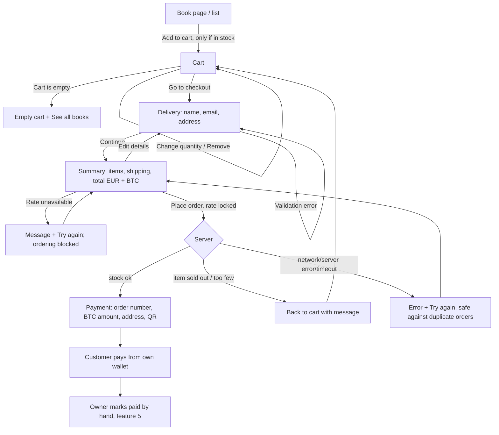

# Design: cart and bitcoin checkout

Feature: #18 · Task: #20 · Release 1 (walking skeleton) · Author: pro-designer

## 1. Purpose

Customers put books in a cart, enter name, email and a Danish address, see the total with flat shipping in EUR and BTC, place the order, and get the owner's bitcoin address and the order number to pay with. There is no payment processing in the shop: the customer sends BTC from their own wallet and the owner marks the order paid by hand. Placing the order reserves stock; the owner cancelling an unpaid order releases it. Denmark only. UI in English only; the shop is called probooks.

Architecture: ADR 0001 (PR #44) states the bitcoin address is configuration (`BTC_ADDRESS`), no private keys are stored, and the backend calls a BTC/EUR rate API. Rate locking, the order number and duplicate protection are settled in section 10. Rounding, storage, rate source and the order URL token are pending pro-architect. Endpoints and data follow pro-architect's contract.

## 2. User flow



The cart lives in the browser until the order is placed (storage per pro-architect). Stock is only reserved at "Place order", so the cart can go stale; the server rechecks on submit.

## 3. Wireframes

### 3.1 Cart (`/cart`)

```
Desktop
+--------------------------------------------------------------------------+
| probooks             [ Search …                    ][Search]    Cart (3) |
+--------------------------------------------------------------------------+
| Your cart                                                                |
|                                                                          |
| [!] "Ørkenens sønner" is now sold out and has been removed from the cart.|  <- if stale
|                                                                          |
| +------+ Book title                        Quantity     Price    Total   |
| |cover | by Author                         [-] [ 2 ] [+] €12.50   €25.00 |
| +------+ In stock                           [Remove]                     |
|          (i) Only 3 in stock                                             |  <- at cap; + disabled
| +------+ Another title                     [-] [10 ] [+]  €8.00   €80.00 |
| |cover | by Author                          [Remove]                     |
| +------+ (i) Max 10 per order                                            |  <- at cap; + disabled
|                                            Subtotal              €33.00  |
|                                            Shipping (Denmark)     €3.00  |
|                                            Total                 €36.00  |
|                                            Price in BTC is shown in the next step |
|                                                                          |
| [‹ Continue shopping]                              [ Go to checkout ]    |
+--------------------------------------------------------------------------+

Mobile
+------------------------------+
| Your cart                    |
| +----+ Book title            |
| |cvr | by Author             |
| +----+ €12.50                |
| Qty [-] [ 3 ] [+]    €37.50  |
| (i) Only 3 in stock          |  <- at cap; + disabled
| [Remove]                     |
|------------------------------|
| Subtotal           €33.00    |
| Shipping            €3.00    |
| Total              €36.00    |
| [    Go to checkout    ]     |
| ‹ Continue shopping          |
+------------------------------+
```

- **Quantity cap (product call on #81):** at most 10 copies per title per order, and never more than what's in stock. The cap is `min(stock, 10)`. ADR 0004 is unchanged.
- `+` is disabled at the cap. The number field clamps to 1…cap (`max` = cap); a typed or pasted higher number is set to the cap.
- At the cap, a short message under the line says why, in plain text with an info icon (never colour alone): "Only {n} in stock" when stock is below 10, "Max 10 per order" when stock is 10 or more. The message is announced via an `aria-live="polite"` region, and the disabled `+` points to it with `aria-describedby`.
- `-` at 1 is disabled; removal goes through "Remove" so a book isn't removed by accident.
- Shipping is a flat €3.00 (user decision), read from configuration.

### 3.2 Checkout form (`/checkout`, step 1 of 2)

```
+--------------------------------------------------------------+
| Checkout                                Step 1 of 2: Delivery |
|                                                               |
| [!] Please fix 2 errors in the form:                          |  <- error summary, links to fields
|     • Enter a valid email address                             |
|     • Postal code must be 4 digits                            |
|                                                               |
| Full name                                                     |
| [______________________________]                              |
|                                                               |
| Email                                                         |
| [______________________________]                              |
| ! Enter a valid email address                                 |
|                                                               |
| Address                                                       |
| [______________________________]  (street, number, floor)     |
|                                                               |
| Address line 2 (optional)                                     |
| [______________________________]  (e.g. c/o)                  |
|                                                               |
| Postal code       City                                        |
| [____]            [____________________]                      |
| ! Postal code must be 4 digits                                |
|                                                               |
| Country: Denmark  (we only ship to Denmark)                   |
|                                                               |
| [‹ Back to cart]                             [ Continue ]     |
+--------------------------------------------------------------+
```

No phone field and no autofill of City in R1. Mobile: one column, full-width fields and buttons. Validation runs on blur after a field has been edited and on Continue; the server validates again.

### 3.3 Order summary (`/checkout/summary`, step 2 of 2)

```
+--------------------------------------------------------------+
| Checkout                                 Step 2 of 2: Summary |
|                                                               |
| Deliver to                                      [Edit]        |
| Mette Hansen, Nygårdsvej 41, 2100 København Ø                 |
| mette@example.dk                                              |
|                                                               |
| Items                                           [Edit cart]   |
| 2 × Book title                                   €25.00       |
| 1 × Another title                                 €8.00       |
| Shipping (Denmark, flat rate)                     €3.00       |
| ------------------------------------------------------------- |
| Total                                            €36.00       |
| Total in bitcoin                      0.00056250 BTC          |
| Rate: 1 BTC = €64,000.00 · fetched at 23:31                   |
| The BTC amount is locked when you place the order.            |
|                                                               |
| You pay with bitcoin from your own wallet after placing the   |
| order. The books are reserved for you when you place the      |
| order.                                                        |
|                                                               |
| [ Place order ]                                               |
+--------------------------------------------------------------+
```

### 3.4 Payment screen (`/order/{token}`)

```
Desktop
+--------------------------------------------------------------------------+
| [✓] Thank you for your order                                             |
| Status: Awaiting payment                                                 |  <- role="status"
|                                                                          |
| [!] Save this page. The payment details are not sent by email.           |
|     [ Print / save page ]                                                |
|                                                                          |
| How to pay                                                               |
| 1. Send exactly this amount in bitcoin:                                  |
|      0.00056250 BTC   [Copy amount]       (= €36.00)                     |
|                                                                          |
| 2. To this bitcoin address:                +--------------------------+  |
|      bc1qxy2k gdyg jrsq tzq2 …             | Payment reference        |  |
|      [Copy address]                        |                          |  |
|                                            |      4827-KM             |  |
|    +-------------+                         |   (large, bold)          |  |
|    |  QR code    |                         | [Copy reference]         |  |
|    +-------------+  Scan with your wallet. +--------------------------+  |
|                                                                          |
| 3. Add the payment reference 4827-KM as a note in your wallet, if it     |
|    supports notes. It is also your order number.                         |
|                                                                          |
| What happens next?                                                       |
| The shop owner checks the payment by hand. This can take up to a few     |
| days. Your books are reserved for you meanwhile.                         |
|                                                                          |
| Order: 2 × Book title, 1 × Another title · Total €36.00                  |
| Delivery: Mette Hansen, c/o Jensen, Nygårdsvej 41, 2100 København Ø      |
+--------------------------------------------------------------------------+
```

Mobile: single column in this order: thanks, status, save notice + button, the reference box, amount, address, QR, steps, what next. The reference box sits right next to (desktop) or directly above (mobile) the address, so the two are seen together.

- **Order number = payment reference:** short and easy to read aloud (`4827-KM` is illustrative: avoid look-alike characters such as 0/O and 1/I). Format per pro-architect.
- **URL:** uses a separate hard-to-guess token defined by pro-architect, never the order number.
- The QR code is a BIP 21 URI (`bitcoin:{address}?amount={btc}`), generated in the browser, dark on white with a quiet zone. The address shows in groups of 4 characters for readability (spacing via CSS), and it copies without spaces.
- **Payment instructions only while Awaiting payment** (#28 Q8). The page reads the order status when it loads (no live updates in R1, R3 #42). Once the order is Paid, Shipped or Cancelled, the page hides the BTC address, amount, QR code, rate, reference box, "How to pay" steps, "What happens next?", save notice and "Print / save page", and shows a status message instead (wireframe below).
- **Status labels are human-readable:** Awaiting payment · Paid · Shipped · Cancelled. Never the raw database value (`awaiting_payment`, `paid`, `shipped`, `cancelled`), and never lower case. One map, shared with the admin `StatusBadge`.

Payment page after a status change (here Cancelled):

```
+--------------------------------------------------------------------------+
| Order 4827-KM                                                            |  <- <h1>
|                                                                          |
| Status: Cancelled                                                        |  <- role="status"
| This order was cancelled. Please don't send a payment.                   |
|                                                                          |
| Order: 2 × Book title, 1 × Another title · Total €36.00                  |
| Delivery: Mette Hansen, c/o Jensen, Nygårdsvej 41, 2100 København Ø      |
+--------------------------------------------------------------------------+
```

| Status | Heading | Status line + message | Instructions (address, amount, QR, rate) |
|---|---|---|---|
| Awaiting payment | Thank you for your order | Status: Awaiting payment | Shown (wireframe above) |
| Paid | Order {ref} | Status: Paid · Payment received. We're getting your order ready. | Hidden |
| Shipped | Order {ref} | Status: Shipped · Your order is on its way. | Hidden |
| Cancelled | Order {ref} | Status: Cancelled · This order was cancelled. Please don't send a payment. | Hidden |

For Paid, Shipped and Cancelled the page keeps the short order and delivery summary (order number, total, deliver-to name and address). R1 has no full item list on these pages.

**R2 only (#95):** long values (email, name, address) wrap with `overflow-wrap: anywhere` and never cause sideways scroll at 320 px.

**Print stylesheet (`@media print`, Awaiting payment only; the other statuses have no print button):** hide the header, search, cart and buttons. Print the shop name, the reference (large), the amount in BTC and EUR, the full address in monospace (not grouped or truncated), the QR code at ≥ 3 cm, the steps, what happens next, and the order and delivery details. Black on white, no backgrounds, fits on one A4 page. "Print / save page" calls `window.print()`, where the browser also offers "Save as PDF".

## 4. BTC amount: rounding and labelling

- EUR is the source price. BTC = total EUR ÷ BTC/EUR rate.
- Shown with 8 decimals (satoshi precision), English format with a dot decimal: `0.00056250 BTC`. Round **up** to the next satoshi so the owner never receives less than the EUR total.
- Copy and the QR code use the same dot decimal with no thousands separator (`0.00056250`), which is what wallets expect. The screen says "Copy amount".
- The rate is always labelled with its time: "Rate: 1 BTC = €64,000.00 · fetched at 23:31".
- **Rate lock (decided):** the BTC amount is locked when the order is placed, with no expiry in R1, so the payment screen and the owner's admin show the same amount. Expiring quotes are R2 #37. pro-architect picks the rate source and refresh interval.
- **Rounding and storage (pending pro-architect):** the round-up to the next satoshi and storing the amount with the order are a proposal. The summary step may refresh the rate. If the rate changes between summary and submit, the payment screen shows the new amount with the note "The amount has been updated to the current rate."

## 5. States

| State | What the customer sees |
|---|---|
| Empty cart | "Your cart is empty." [See all books]. Header shows "Cart (0)". Going to `/checkout` with an empty cart redirects to the cart. |
| Added to cart | On the book page: "Added to cart" + [Go to cart]; header count updates. |
| Out of stock on book page | No "Add to cart" button (rule from #14). |
| Quantity at the stock limit (stock < 10) | `+` disabled; message "Only {n} in stock" (polite live region, icon + text). A typed higher number is clamped to {n}, with "Only {n} in stock. Quantity set to {n}." |
| Quantity at the order limit (stock ≥ 10) | `+` disabled at 10; message "Max 10 per order" (polite live region, icon + text). A typed higher number is clamped to 10, with "Max 10 per order. Quantity set to 10." |
| Below the cap again | After `-` or a lower typed value, `+` is enabled again and the cap message disappears. |
| Item sold out or reserved meanwhile (cart load) | Banner "‘{title}’ is now sold out and has been removed from the cart." or "Only {n} of ‘{title}’ left. Quantity updated." Totals update. |
| Item sold out or reserved meanwhile (on submit) | Back to the cart with the same banner; "Nothing has been ordered yet. Check your cart and try again." |
| Validation errors | Error summary at the top (focus moves there) plus inline errors per field (section 7). |
| BTC rate loading | Summary: "Fetching bitcoin rate …" in the BTC row; "Place order" disabled. |
| BTC rate unavailable | "We can't fetch the bitcoin rate right now, so we can't work out the BTC amount. Please try again in a moment." [Try again]. "Place order" stays disabled, so no order is ever placed without a BTC amount. |
| Submitting | Button "Placing order …", disabled; no double submit. |
| Duplicate protection (requirement) | "Try again" after a failure or timeout must never create a second order. If the first attempt succeeded, the retry opens that order's payment page. pro-architect defines the mechanism. |
| Submit failure | "Your order wasn't placed. Nothing has been charged or reserved. Please try again." [Try again]. Entered details are kept. On a timeout, "Try again" is safe (duplicate protection). |
| Order placed | Payment screen (3.4). The cart empties. |
| Payment page reloaded / revisited | Same content from the saved order (rate locked) while Awaiting payment. |
| Payment page, Awaiting payment | Instructions shown (3.4) with "Status: Awaiting payment" under the heading. |
| Payment page, Paid | Instructions hidden (no BTC address, amount, QR or rate). Heading "Order {ref}", "Status: Paid", "Payment received. We're getting your order ready." Order and delivery summary stay. |
| Payment page, Shipped | Instructions hidden. "Status: Shipped", "Your order is on its way." Order and delivery summary stay. |
| Payment page, Cancelled | Instructions hidden. "Status: Cancelled", "This order was cancelled. Please don't send a payment." Order and delivery summary stay. |
| Copy success | "Copied" appears beside the button for 2 s and is announced. On failure: "Couldn't copy. Select the text and copy it yourself." |
| Print / save | "Print / save page" opens the browser print dialog with the print layout (3.4). |

## 6. Edge cases

| Case | Handling |
|---|---|
| Two customers want the last copy | The first submit wins; the second gets the sold-out-on-submit state. |
| Cart kept for days | Revalidated against stock and price on cart load and on submit; price changes show "The price of ‘{title}’ has changed to {price}." |
| Postal code | Exactly 4 digits (`^[0-9]{4}$`), `inputmode="numeric"`. Leading zero is not valid in DK, but accept 1000–9999 and leave the full list to the backend. |
| City auto-filled from postal code | Not in R1. |
| Foreign address | Only Denmark; the country is fixed text, not a field. |
| Name with æøå, hyphens, apostrophes | Allowed; no character restrictions beyond length 1–100. Danish street and city names (Nygårdsvej, København Ø) must work. |
| Email typo | Format check only; the email is echoed on the summary and the payment screen so the customer can spot it. |
| Many copies of one book | Quantity max is `min(stock, 10)` per title per order (#81). Server rejects more; the cart never sends more. |
| Stock drops below cart quantity | Stale-item banner "Only {n} of ‘{title}’ left. Quantity updated."; the cap becomes the new stock. |
| Very long titles | 2 lines in the cart, ellipsis; full title in the accessible name. |
| BTC amount very small | Still 8 decimals; never show `0 BTC`. |
| Rate spikes between summary and submit | Order uses the rate at submit; note shown (section 4). |
| Customer closes payment page | Save notice and print button; the token URL can be reopened from history or bookmarks. No email with instructions in R1 (R2 "Order received email"). |
| Address line 2 empty | Omitted from summaries; no stray comma. |

## 7. UI copy

| Key | English |
|---|---|
| Header cart | Cart ({n}) |
| Add to cart / added | Add to cart / Added to cart · Go to cart |
| Cart heading | Your cart |
| Cart columns | Quantity · Price · Total |
| Quantity buttons (accessible) | Fewer of {title} · More of {title} · Quantity of {title} |
| Remove | Remove ({title} in accessible name) |
| Cap message, stock limit | Only {n} in stock |
| Cap message, order limit | Max 10 per order |
| Clamped, stock limit | Only {n} in stock. Quantity set to {n}. |
| Clamped, order limit | Max 10 per order. Quantity set to 10. |
| Subtotal / shipping / total | Subtotal · Shipping (Denmark) · Total |
| BTC later | Price in BTC is shown in the next step |
| Buttons | Continue shopping · Go to checkout · Back to cart · Continue · Edit · Edit cart · Place order · Placing order … · Try again |
| Empty cart | Your cart is empty. · See all books |
| Stale item | ‘{title}’ is now sold out and has been removed from the cart. · Only {n} of ‘{title}’ left. Quantity updated. · The price of ‘{title}’ has changed to {price}. |
| Stale on submit | Nothing has been ordered yet. Check your cart and try again. |
| Checkout heading / steps | Checkout · Step 1 of 2: Delivery · Step 2 of 2: Summary |
| Fields | Full name · Email · Address · Address line 2 (optional) · Postal code · City |
| Address line 2 hint | E.g. c/o |
| Address hint | Street, number and floor if any |
| Email hint | **R2 only (#30), not in R1:** We'll email you when your order is paid and shipped. R1 shows no email hint. |
| Country | Country: Denmark (we only ship to Denmark) |
| Error summary | Please fix {n} errors in the form: |
| Field errors | Enter your name · Enter your email · Enter a valid email address · Enter your address · Enter your postal code · Postal code must be 4 digits · Enter your city |
| Summary | Deliver to · Items · Shipping (Denmark, flat rate) · Total · Total in bitcoin · Rate: 1 BTC = {rate} · fetched at {time} |
| Summary note | You pay with bitcoin from your own wallet after placing the order. The books are reserved for you when you place the order. |
| Rate loading / unavailable | Fetching bitcoin rate … · We can't fetch the bitcoin rate right now, so we can't work out the BTC amount. Please try again in a moment. |
| Rate updated | The amount has been updated to the current rate. |
| Submit failure | Your order wasn't placed. Nothing has been charged or reserved. Please try again. |
| Payment heading | Thank you for your order |
| Reference | Payment reference · It is also your order number. · Copy reference |
| Rate lock note | The BTC amount is locked when you place the order. |
| Steps | How to pay · 1. Send exactly this amount in bitcoin: · 2. To this bitcoin address: · 3. Add the payment reference {ref} as a note in your wallet, if it supports notes. It is also your order number. |
| QR | Scan with your wallet. The QR code contains the address and the amount. |
| Copy buttons | Copy reference · Copy amount · Copy address |
| Copy result | Copied · Couldn't copy. Select the text and copy it yourself. |
| What next (R1) | What happens next? · The shop owner checks the payment by hand. This can take up to a few days. Your books are reserved for you meanwhile. |
| What next, email sentence | **R2 only (#30), not in R1:** You'll get an email when the payment is confirmed, and again when the books are shipped. |
| Save notice | Save this page. The payment details are not sent by email. |
| Payment page status labels | Status: {label} · Awaiting payment · Paid · Shipped · Cancelled (never raw database values) |
| Payment page heading after a status change | Order {ref} |
| Status message, Paid | Payment received. We're getting your order ready. |
| Status message, Shipped | Your order is on its way. |
| Status message, Cancelled | This order was cancelled. Please don't send a payment. |
| Print button | Print / save page |

R1 copy has no "we'll email you" sentences: payment and shipping emails moved to R2 (#30).

Numbers: `€36.00`, `0.00056250 BTC`, `1 BTC = €64,000.00`, time 24-hour `23:31`.

## 8. Accessibility (WCAG 2.1 AA)

- `lang="en"`. Each step has its own `<h1>` and page title ("Checkout – Delivery – probooks"); the step indicator is text ("Step 1 of 2"), not just a graphic.
- **Form:** visible `<label for>` on every field; `autocomplete` = `name`, `email`, `street-address`, `postal-code`, `address-level2`; `type="email"`, postal code `inputmode="numeric"` `maxlength="4"`. Required fields are marked "(required)" in the label or all fields are required and the form says so.
- **Errors:** on submit, an error summary with `role="alert"` and `tabindex="-1"` gets focus; each item links to its field. Fields get `aria-invalid="true"` and `aria-describedby` pointing to the inline error. Errors use text and an icon, not only red.
- **Cart:** quantity controls are buttons with accessible names including the title; the quantity input is `type="number"` with `min`/`max` (max = `min(stock, 10)`). The cap message ("Only {n} in stock" / "Max 10 per order") is in an `aria-live="polite"` region, uses an icon and text (not colour alone), and the disabled `+` references it with `aria-describedby`. Totals and stale-item banners update in an `aria-live="polite"` region ("Total updated: €36.00"). After "Remove", focus moves to the next item or the cart heading.
- **Copy buttons:** a `<button>` with a specific name ("Copy bitcoin address"); success "Copied" in an `aria-live="polite"` region next to it; failure in the same region. The copied text stays visible and selectable.
- **QR code:** `` (or `role="img"` with the same label). It is never the only way: the address and amount are shown as text with copy buttons.
- **Rate unavailable / submit failure:** `role="alert"`; the disabled "Place order" explains why via `aria-describedby`.
- **Reference:** the reference box is a labelled region (`<section aria-labelledby>` "Payment reference") and the code is plain text in at least 24 px, with no look-alike characters. Its copy button follows the copy-button rules.
- **Print / save:** a real `<button>` named "Print / save page". The save notice is plain text near the top, not a dismissible toast, so it's read in order. The print layout keeps the reference, amount and address as real text, so a saved PDF stays searchable and readable by screen readers. Don't rely on colour in print.
- **Payment screen:** focus moves to the "Thank you for your order" heading (or "Order {ref}" once the order is no longer awaiting payment). The status line ("Status: Paid" + message) is in a `role="status"` element right after the `<h1>`, as plain text. Hidden instructions are not rendered at all (not just visually hidden), so screen readers and copy never get the address or amount of a paid, shipped or cancelled order. The BTC address is in a monospaced font at ≥ 16 px; the visual 4-character spacing uses CSS, not real spaces, so screen readers and copy get the plain address.
- Contrast: text ≥ 4.5:1, controls and focus ≥ 3:1; QR dark on white. Targets ≥ 24×24 px (44 px on mobile). Reflow at 320 px and 200 % zoom.
- No time limits in R1. If R2 adds quote expiry, it must warn and allow a refresh (WCAG 2.2.1).

## 9. Acceptance criteria mapping (#18)

| Acceptance criterion | Spec sections |
|---|---|
| Customers can add, change and remove cart items. | 2, 3.1, 5 (empty cart, added), 7, 8 (cart) |
| Customers cannot put more of a book in the cart or order than is in stock. | 3.1 (cap = min(stock, 10), + disabled, cap message), 5 (stock limit, order limit, sold out meanwhile on load and submit), 6 (last copy) |
| Checkout asks for name, email and a Danish address. | 3.2 (incl. address line 2), 5 (validation), 6 (postal code, foreign address), 7, 8 (form, errors), 10.3, 10.9 |
| A flat shipping fee is added. | 3.1, 3.3 (Shipping (Denmark, flat rate)), 10.5 |
| The summary shows the total in EUR and BTC at the current rate. | 3.3, 4 (rate lock), 5 (rate loading/unavailable), 10.1–10.2 |
| The confirmation shows the owner's bitcoin address and the order number to use as reference. | 3.4 (reference box, print), 4, 5 (copy, print), 8 (copy, QR, reference, print), 10.4, 10.8 |
| Placing the order reserves the stock (stock goes down at once). | 2, 3.3 note, 3.4 "reserved", 5 (sold out on submit, duplicate protection), 6 (last copy), 10.6 |
| At most 10 copies of a title per order (#81, #79). | 3.1 (cap, order-limit message), 5 (order limit), 6 (many copies), 7 (cap messages), 8 (cart) |
| The order is saved as awaiting payment. No private keys are stored. | 1 (ADR 0001), 3.4 (what happens next), 5 (payment page revisited) |
| The payment page shows the instructions only while the order is Awaiting payment; Paid, Shipped and Cancelled show a status message and no BTC address, amount, QR or rate, with human-readable status labels (#28 Q8). | 3.4 (status table, wireframe), 5 (payment page by status), 7 (status labels and messages), 8 (payment screen) |

## 10. Resolved decisions

Answered by pro-product-owner.

1. **Rate lock:** the rate is locked when the order is placed, with no expiry in R1. Expiring quotes are R2 #37. pro-architect picks the rate source and refresh interval.
2. **Rounding and storage:** pro-architect's call. The proposal in section 4 (round up to the next satoshi, amount stored with the order) stands, **pending pro-architect**.
3. **City autofill:** not in R1.
4. **Order number and URL:** the customer sees a short order number they can read aloud, which is also the payment reference, shown prominently next to the address. The page URL uses a separate hard-to-guess token defined by pro-architect.
5. **Shipping:** flat €3.00, Denmark only (user decision; replaces the €5.00 placeholder). Read from configuration.
6. **Duplicate protection (requirement):** "Try again" must be safe and never create duplicate orders. pro-architect defines how.
7. **Live order status:** not in R1 (R3 #42).
8. **Print / save:** a "Print / save page" button and a clear line telling the customer to save the page, with a print stylesheet (3.4, 8).
9. **Fields:** no phone field. An optional second address line, "Address line 2 (optional)", for c/o. Danish address fields stay: postal code (4 digits) and city.
10. **UI language: English only (user decision 2026-10-20).** All copy in this spec is English; `lang="en"`.
11. **Shop name:** probooks (replaces the placeholder "Boghandel").
12. **Price format:** English format everywhere, e.g. `€12.50`, `€64,000.00`; BTC with a dot decimal, `0.00056250 BTC`.
13. **Quantity cap (#81):** at most 10 copies per title per order and never more than stock; the cart caps at `min(stock, 10)`. ADR 0004 is unchanged.
14. **Emails:** order-paid and shipped emails are R2 (#30). Every "we'll email you" sentence in this spec is R2 only and is left out of R1 copy.
15. **Payment page by status (#28 Q8):** instructions only while Awaiting payment; Paid, Shipped and Cancelled hide them and show a status message; human-readable labels (3.4).

Pending pro-architect: rounding and storage, the rate source and refresh interval, the order number format, the URL token, and the duplicate-protection mechanism.
