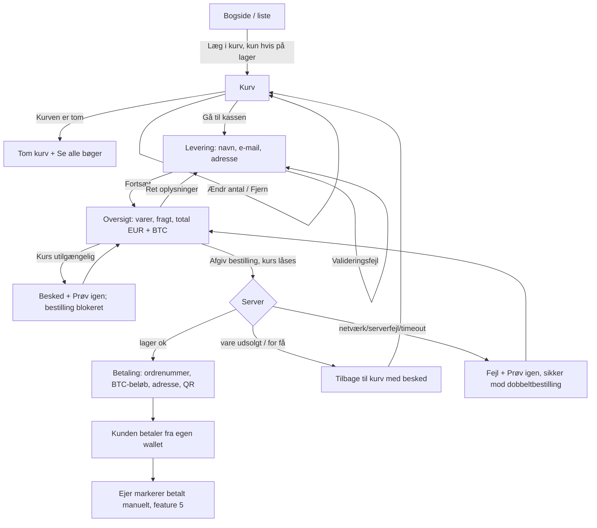

# Design: cart and bitcoin checkout

Feature: #18 · Task: #20 · Release 1 (walking skeleton) · Author: pro-designer

## 1. Purpose

Customers put books in a cart, enter name, email and a Danish address, see the total with flat shipping in EUR and BTC, place the order, and get the owner's bitcoin address and the order number to pay with. There is no payment processing in the shop: the customer sends BTC from their own wallet and the owner marks the order paid by hand. Placing the order reserves stock; the owner cancelling an unpaid order releases it. Denmark only. UI in Danish; shop name stays the placeholder "Boghandel".

Architecture: ADR 0001 (PR #44) states the bitcoin address is configuration (`BTC_ADDRESS`), no private keys are stored, and the backend calls a BTC/EUR rate API. Rate locking, the order number and duplicate protection are settled in section 10. Rounding, storage, rate source and the order URL token are pending pro-architect. Endpoints and data follow pro-architect's contract.

## 2. User flow



The cart lives in the browser until the order is placed (storage per pro-architect). Stock is only reserved at "Afgiv bestilling", so the cart can go stale; the server rechecks on submit.

## 3. Wireframes

### 3.1 Cart (`/kurv`)

```
Desktop
+--------------------------------------------------------------------------+
| Boghandel            [ Søg …                       ][Søg]       Kurv (3) |
+--------------------------------------------------------------------------+
| Din kurv                                                                 |
|                                                                          |
| [!] "Ørkenens sønner" er nu udsolgt og er fjernet fra kurven.            |  <- if stale
|                                                                          |
| +------+ Titel på bogen                    Antal        Pris     I alt   |
| |cover | af Forfatter                      [-] [ 2 ] [+] 12,50 €  25,00 € |
| +------+ På lager · Højst 3 stk.            [Fjern]                      |
| +------+ En anden titel                    [-] [ 1 ] [+]  8,00 €   8,00 € |
| |cover | af Forfatter                       [Fjern]                      |
| +------+                                                                 |
|                                            Varer i alt          33,00 €  |
|                                            Fragt (Danmark)       5,00 €  |
|                                            Total                38,00 €  |
|                                            Pris i BTC vises ved næste trin |
|                                                                          |
| [‹ Fortsæt med at handle]                          [ Gå til kassen ]     |
+--------------------------------------------------------------------------+

Mobile
+------------------------------+
| Din kurv                     |
| +----+ Titel på bogen        |
| |cvr | af Forfatter          |
| +----+ 12,50 €               |
| Antal [-] [ 2 ] [+]  25,00 € |
| [Fjern]                      |
|------------------------------|
| Varer i alt        33,00 €   |
| Fragt               5,00 €   |
| Total              38,00 €   |
| [     Gå til kassen     ]    |
| ‹ Fortsæt med at handle      |
+------------------------------+
```

- `+` is disabled at the available stock, with the hint "Højst {n} stk." The number field clamps to 1…available.
- `-` at 1 is disabled; removal goes through "Fjern" so a book isn't removed by accident.
- The shipping amount comes from configuration (5,00 € shown is a placeholder).

### 3.2 Checkout form (`/kassen`, step 1 of 2)

```
+--------------------------------------------------------------+
| Kassen                                   Trin 1 af 2: Levering |
|                                                               |
| [!] Ret 2 fejl i formularen:                                  |  <- error summary, links to fields
|     • Indtast en gyldig e-mailadresse                         |
|     • Postnummeret skal være 4 cifre                          |
|                                                               |
| Fulde navn                                                    |
| [______________________________]                              |
|                                                               |
| E-mail                                                        |
| [______________________________]                              |
| Vi sender besked, når din bestilling er betalt og afsendt.    |
| ! Indtast en gyldig e-mailadresse                             |
|                                                               |
| Adresse                                                       |
| [______________________________]  (gade, nr., etage)          |
|                                                               |
| Adresselinje 2 (valgfri)                                      |
| [______________________________]  (fx c/o)                    |
|                                                               |
| Postnummer        By                                          |
| [____]            [____________________]                      |
| ! Postnummeret skal være 4 cifre                              |
|                                                               |
| Land: Danmark  (vi sender kun til Danmark)                    |
|                                                               |
| [‹ Tilbage til kurven]                       [ Fortsæt ]      |
+--------------------------------------------------------------+
```

No phone field and no autofill of By in R1. Mobile: one column, full-width fields and buttons. Validation runs on blur after a field has been edited and on Fortsæt; the server validates again.

### 3.3 Order summary (`/kassen/oversigt`, step 2 of 2)

```
+--------------------------------------------------------------+
| Kassen                                  Trin 2 af 2: Oversigt |
|                                                               |
| Levering til                                    [Ret]         |
| Mette Hansen, Nygårdsvej 41, 2100 København Ø                 |
| mette@example.dk                                              |
|                                                               |
| Varer                                           [Ret kurv]    |
| 2 × Titel på bogen                               25,00 €      |
| 1 × En anden titel                                8,00 €      |
| Fragt (Danmark, fast pris)                        5,00 €      |
| ------------------------------------------------------------- |
| Total                                            38,00 €      |
| Total i bitcoin                       0,00059375 BTC          |
| Kurs: 1 BTC = 64.000,00 € · hentet kl. 23:31                  |
| Beløbet i BTC låses, når du afgiver bestillingen.             |
|                                                               |
| Du betaler med bitcoin fra din egen wallet, når bestillingen  |
| er afgivet. Bøgerne er reserveret til dig, når du afgiver     |
| bestillingen.                                                 |
|                                                               |
| [ Afgiv bestilling ]                                          |
+--------------------------------------------------------------+
```

### 3.4 Payment screen (`/ordre/{token}`)

```
Desktop
+--------------------------------------------------------------------------+
| [✓] Tak for din bestilling                                               |
|                                                                          |
| [!] Gem denne side. Du får ikke betalingsoplysningerne på e-mail.        |
|     [ Udskriv / gem siden ]                                              |
|                                                                          |
| Sådan betaler du                                                         |
| 1. Send præcis dette beløb i bitcoin:                                    |
|      0,00059375 BTC   [Kopiér beløb]      (= 38,00 €)                    |
|                                                                          |
| 2. Til denne bitcoin-adresse:              +--------------------------+  |
|      bc1qxy2k gdyg jrsq tzq2 …             | Betalingsreference       |  |
|      [Kopiér adresse]                      |                          |  |
|                                            |      4827-KM             |  |
|    +-------------+                         |   (stor, fed skrift)     |  |
|    |  QR-kode    |                         | [Kopiér reference]       |  |
|    +-------------+  Scan med din wallet.   +--------------------------+  |
|                                                                          |
| 3. Skriv betalingsreferencen 4827-KM som note i din wallet, hvis den     |
|    kan det. Det er også dit ordrenummer.                                 |
|                                                                          |
| Hvad sker der nu?                                                        |
| Butikkens ejer tjekker betalingen manuelt. Det kan tage op til et par    |
| dage. Du får en e-mail, når betalingen er bekræftet, og igen, når        |
| bøgerne er sendt. Dine bøger er reserveret til dig imens.                |
|                                                                          |
| Bestilling: 2 × Titel på bogen, 1 × En anden titel · Total 38,00 €       |
| Levering: Mette Hansen, c/o Jensen, Nygårdsvej 41, 2100 København Ø      |
+--------------------------------------------------------------------------+
```

Mobile: single column in this order: thanks, save notice + button, the reference box, amount, address, QR, steps, what next. The reference box sits right next to (desktop) or directly above (mobile) the address, so the two are seen together.

- **Order number = payment reference:** short and easy to read aloud (`4827-KM` is illustrative: avoid look-alike characters such as 0/O and 1/I). Format per pro-architect.
- **URL:** uses a separate hard-to-guess token defined by pro-architect, never the order number.
- The QR code is a BIP 21 URI (`bitcoin:{adresse}?amount={btc}`), generated in the browser, dark on white with a quiet zone. The address shows in groups of 4 characters for readability (spacing via CSS), and it copies without spaces.
- No live order status in R1 (R3 #42). The page shows instructions only.

**Print stylesheet (`@media print`):** hide the header, search, cart and buttons. Print the shop name, the reference (large), the amount in BTC and EUR, the full address in monospace (not grouped or truncated), the QR code at ≥ 3 cm, the steps, what happens next, and the order and delivery details. Black on white, no backgrounds, fits on one A4 page. "Udskriv / gem siden" calls `window.print()`, where the browser also offers "Gem som PDF".

## 4. BTC amount: rounding and labelling

- EUR is the source price. BTC = total EUR ÷ BTC/EUR rate.
- Shown with 8 decimals (satoshi precision), Danish format: `0,00059375 BTC`. Round **up** to the next satoshi so the owner never receives less than the EUR total.
- Copy and the QR code use a dot decimal with no thousands separator (`0.00059375`), because wallets expect that. The screen says "Kopiér beløb" and copies the wallet format.
- The rate is always labelled with its time: "Kurs: 1 BTC = 64.000,00 € · hentet kl. 23:31".
- **Rate lock (decided):** the BTC amount is locked when the order is placed, with no expiry in R1, so the payment screen and the owner's admin show the same amount. Expiring quotes are R2 #37. pro-architect picks the rate source and refresh interval.
- **Rounding and storage (pending pro-architect):** the round-up to the next satoshi and storing the amount with the order are a proposal. The summary step may refresh the rate. If the rate changes between summary and submit, the payment screen shows the new amount with the note "Beløbet er opdateret efter den aktuelle kurs."

## 5. States

| State | What the customer sees |
|---|---|
| Empty cart | "Din kurv er tom." [Se alle bøger]. Header shows "Kurv (0)". Going to `/kassen` with an empty cart redirects to the cart. |
| Added to cart | On the book page: "Lagt i kurven" + [Gå til kurven]; header count updates. |
| Out of stock on book page | No "Læg i kurv" button (rule from #14). |
| Quantity above stock | `+` disabled at the available count, with the hint "Højst {n} stk." A typed higher number is clamped, with the message "Der er kun {n} stk. på lager. Antallet er sat til {n}." |
| Item sold out or reserved meanwhile (cart load) | Banner "‘{titel}’ er nu udsolgt og er fjernet fra kurven." or "Der er nu kun {n} stk. af ‘{titel}’. Antallet er ændret." Totals update. |
| Item sold out or reserved meanwhile (on submit) | Back to the cart with the same banner; "Intet er bestilt endnu. Tjek kurven og prøv igen." |
| Validation errors | Error summary at the top (focus moves there) plus inline errors per field (section 7). |
| BTC rate loading | Summary: "Henter bitcoin-kurs …" in the BTC row; "Afgiv bestilling" disabled. |
| BTC rate unavailable | "Vi kan ikke hente bitcoin-kursen lige nu, så vi kan ikke beregne beløbet i BTC. Prøv igen om lidt." [Prøv igen]. "Afgiv bestilling" stays disabled, so no order is ever placed without a BTC amount. |
| Submitting | Button "Afgiver bestilling …", disabled; no double submit. |
| Duplicate protection (requirement) | "Prøv igen" after a failure or timeout must never create a second order. If the first attempt succeeded, the retry opens that order's payment page. pro-architect defines the mechanism. |
| Submit failure | "Bestillingen blev ikke afgivet. Der er ikke trukket noget, og intet er reserveret. Prøv igen." [Prøv igen]. Entered details are kept. On a timeout, "Prøv igen" is safe (duplicate protection). |
| Order placed | Payment screen (3.4). The cart empties. |
| Payment page reloaded / revisited | Same content from the saved order (rate locked). |
| Copy success | "Kopieret" appears beside the button for 2 s and is announced. On failure: "Kunne ikke kopiere. Markér teksten og kopiér den selv." |
| Print / save | "Udskriv / gem siden" opens the browser print dialog with the print layout (3.4). |

## 6. Edge cases

| Case | Handling |
|---|---|
| Two customers want the last copy | The first submit wins; the second gets the sold-out-on-submit state. |
| Cart kept for days | Revalidated against stock and price on cart load and on submit; price changes show "Prisen på ‘{titel}’ er ændret til {pris}." |
| Postnummer | Exactly 4 digits (`^[0-9]{4}$`), `inputmode="numeric"`. Leading zero is not valid in DK, but accept 1000–9999 and leave the full list to the backend. |
| By auto-filled from postnummer | Not in R1. |
| Foreign address | Only Denmark; the country is fixed text, not a field. |
| Name with æøå, hyphens, apostrophes | Allowed; no character restrictions beyond length 1–100. |
| Email typo | Format check only; the email is echoed on the summary and the payment screen so the customer can spot it. |
| Many copies of one book | Quantity max is the available stock (no other cap in R1). |
| Very long titles | 2 lines in the cart, ellipsis; full title in the accessible name. |
| BTC amount very small | Still 8 decimals; never show `0 BTC`. |
| Rate spikes between summary and submit | Order uses the rate at submit; note shown (section 4). |
| Customer closes payment page | Save notice and print button; the token URL can be reopened from history or bookmarks. No email with instructions in R1 (R2 "Order received email"). |
| Address line 2 empty | Omitted from summaries; no stray comma. |

## 7. Danish copy

| Key | Danish |
|---|---|
| Header cart | Kurv ({n}) |
| Add to cart / added | Læg i kurv / Lagt i kurven · Gå til kurven |
| Cart heading | Din kurv |
| Cart columns | Antal · Pris · I alt |
| Quantity buttons (accessible) | Færre af {titel} · Flere af {titel} · Antal af {titel} |
| Remove | Fjern ({titel} in accessible name) |
| Max hint | Højst {n} stk. |
| Clamped | Der er kun {n} stk. på lager. Antallet er sat til {n}. |
| Subtotal / shipping / total | Varer i alt · Fragt (Danmark) · Total |
| BTC later | Pris i BTC vises ved næste trin |
| Buttons | Fortsæt med at handle · Gå til kassen · Tilbage til kurven · Fortsæt · Ret · Ret kurv · Afgiv bestilling · Afgiver bestilling … · Prøv igen |
| Empty cart | Din kurv er tom. · Se alle bøger |
| Stale item | ‘{titel}’ er nu udsolgt og er fjernet fra kurven. · Der er nu kun {n} stk. af ‘{titel}’. Antallet er ændret. · Prisen på ‘{titel}’ er ændret til {pris}. |
| Stale on submit | Intet er bestilt endnu. Tjek kurven og prøv igen. |
| Checkout heading / steps | Kassen · Trin 1 af 2: Levering · Trin 2 af 2: Oversigt |
| Fields | Fulde navn · E-mail · Adresse · Adresselinje 2 (valgfri) · Postnummer · By |
| Address line 2 hint | Fx c/o |
| Address hint | Gade, nummer og evt. etage |
| Email hint | Vi sender besked, når din bestilling er betalt og afsendt. |
| Country | Land: Danmark (vi sender kun til Danmark) |
| Error summary | Ret {n} fejl i formularen: |
| Field errors | Indtast dit navn · Indtast din e-mail · Indtast en gyldig e-mailadresse · Indtast din adresse · Indtast dit postnummer · Postnummeret skal være 4 cifre · Indtast din by |
| Summary | Levering til · Varer · Fragt (Danmark, fast pris) · Total · Total i bitcoin · Kurs: 1 BTC = {kurs} € · hentet kl. {tid} |
| Summary note | Du betaler med bitcoin fra din egen wallet, når bestillingen er afgivet. Bøgerne er reserveret til dig, når du afgiver bestillingen. |
| Rate loading / unavailable | Henter bitcoin-kurs … · Vi kan ikke hente bitcoin-kursen lige nu, så vi kan ikke beregne beløbet i BTC. Prøv igen om lidt. |
| Rate updated | Beløbet er opdateret efter den aktuelle kurs. |
| Submit failure | Bestillingen blev ikke afgivet. Der er ikke trukket noget, og intet er reserveret. Prøv igen. |
| Payment heading | Tak for din bestilling |
| Reference | Betalingsreference · Det er også dit ordrenummer. · Kopiér reference |
| Rate lock note | Beløbet i BTC låses, når du afgiver bestillingen. |
| Steps | Sådan betaler du · 1. Send præcis dette beløb i bitcoin: · 2. Til denne bitcoin-adresse: · 3. Skriv betalingsreferencen {ref} som note i din wallet, hvis den kan det. Det er også dit ordrenummer. |
| QR | Scan med din wallet. QR-koden indeholder adressen og beløbet. |
| Copy buttons | Kopiér reference · Kopiér beløb · Kopiér adresse |
| Copy result | Kopieret · Kunne ikke kopiere. Markér teksten og kopiér den selv. |
| What next | Hvad sker der nu? · Butikkens ejer tjekker betalingen manuelt. Det kan tage op til et par dage. Du får en e-mail, når betalingen er bekræftet, og igen, når bøgerne er sendt. Dine bøger er reserveret til dig imens. |
| Save notice | Gem denne side. Du får ikke betalingsoplysningerne på e-mail. |
| Print button | Udskriv / gem siden |

Numbers: `38,00 €`, `0,00059375 BTC`, `1 BTC = 64.000,00 €`, time `kl. 23:31`.

## 8. Accessibility (WCAG 2.1 AA)

- `lang="da"`. Each step has its own `<h1>` and page title ("Kassen – Levering – Boghandel"); the step indicator is text ("Trin 1 af 2"), not just a graphic.
- **Form:** visible `<label for>` on every field; `autocomplete` = `name`, `email`, `street-address`, `postal-code`, `address-level2`; `type="email"`, postnummer `inputmode="numeric"` `maxlength="4"`. Required fields are marked "(skal udfyldes)" in the label or all fields are required and the form says so.
- **Errors:** on submit, an error summary with `role="alert"` and `tabindex="-1"` gets focus; each item links to its field. Fields get `aria-invalid="true"` and `aria-describedby` pointing to the inline error. Errors use text and an icon, not only red.
- **Cart:** quantity controls are buttons with accessible names including the title; the quantity input is `type="number"` with `min`/`max`. Totals and stale-item banners update in an `aria-live="polite"` region ("Total opdateret: 38,00 €"). After "Fjern", focus moves to the next item or the cart heading.
- **Copy buttons:** a `<button>` with a specific name ("Kopiér bitcoin-adresse"); success "Kopieret" in an `aria-live="polite"` region next to it; failure in the same region. The copied text stays visible and selectable.
- **QR code:** `` (or `role="img"` with the same label). It is never the only way: the address and amount are shown as text with copy buttons.
- **Rate unavailable / submit failure:** `role="alert"`; the disabled "Afgiv bestilling" explains why via `aria-describedby`.
- **Reference:** the reference box is a labelled region (`<section aria-labelledby>` "Betalingsreference") and the code is plain text in at least 24 px, with no look-alike characters. Its copy button follows the copy-button rules.
- **Print / save:** a real `<button>` named "Udskriv / gem siden". The save notice is plain text near the top, not a dismissible toast, so it's read in order. The print layout keeps the reference, amount and address as real text, so a saved PDF stays searchable and readable by screen readers. Don't rely on colour in print.
- **Payment screen:** focus moves to the "Tak for din bestilling" heading. The BTC address is in a monospaced font at ≥ 16 px; the visual 4-character spacing uses CSS, not real spaces, so screen readers and copy get the plain address.
- Contrast: text ≥ 4.5:1, controls and focus ≥ 3:1; QR dark on white. Targets ≥ 24×24 px (44 px on mobile). Reflow at 320 px and 200 % zoom.
- No time limits in R1. If R2 adds quote expiry, it must warn and allow a refresh (WCAG 2.2.1).

## 9. Acceptance criteria mapping (#18)

| Acceptance criterion | Spec sections |
|---|---|
| Customers can add, change and remove cart items. | 2, 3.1, 5 (empty cart, added), 7, 8 (cart) |
| Customers cannot put more of a book in the cart or order than is in stock. | 3.1 (+ disabled, max hint), 5 (quantity above stock, sold out meanwhile on load and submit), 6 (last copy) |
| Checkout asks for name, email and a Danish address. | 3.2 (incl. address line 2), 5 (validation), 6 (postnummer, foreign address), 7, 8 (form, errors), 10.3, 10.9 |
| A flat shipping fee is added. | 3.1, 3.3 (Fragt (Danmark, fast pris)), 10.5 |
| The summary shows the total in EUR and BTC at the current rate. | 3.3, 4 (rate lock), 5 (rate loading/unavailable), 10.1–10.2 |
| The confirmation shows the owner's bitcoin address and the order number to use as reference. | 3.4 (reference box, print), 4, 5 (copy, print), 8 (copy, QR, reference, print), 10.4, 10.8 |
| Placing the order reserves the stock (stock goes down at once). | 2, 3.3 note, 3.4 "reserveret", 5 (sold out on submit, duplicate protection), 6 (last copy), 10.6 |
| The order is saved as awaiting payment. No private keys are stored. | 1 (ADR 0001), 3.4 (what happens next), 5 (payment page revisited) |

## 10. Resolved decisions

Answered by pro-product-owner.

1. **Rate lock:** the rate is locked when the order is placed, with no expiry in R1. Expiring quotes are R2 #37. pro-architect picks the rate source and refresh interval.
2. **Rounding and storage:** pro-architect's call. The proposal in section 4 (round up to the next satoshi, amount stored with the order) stands, **pending pro-architect**.
3. **By autofill:** not in R1.
4. **Order number and URL:** the customer sees a short order number they can read aloud, which is also the payment reference, shown prominently next to the address. The page URL uses a separate hard-to-guess token defined by pro-architect.
5. **Shipping:** 5,00 €, a configurable placeholder.
6. **Duplicate protection (requirement):** "Prøv igen" must be safe and never create duplicate orders. pro-architect defines how.
7. **Live order status:** not in R1 (R3 #42).
8. **Print / save:** an "Udskriv / gem siden" button and a clear line telling the customer to save the page, with a print stylesheet (3.4, 8).
9. **Fields:** no phone field. An optional second address line, "Adresselinje 2 (valgfri)", for c/o.

Pending pro-architect: rounding and storage, the rate source and refresh interval, the order number format, the URL token, and the duplicate-protection mechanism.
