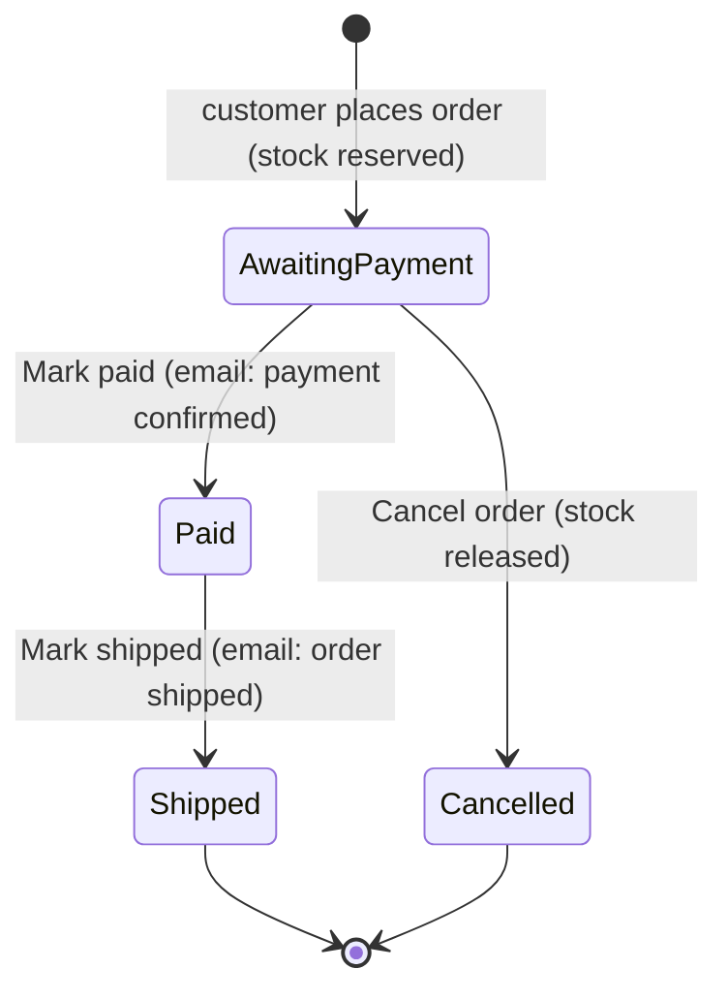

# Design: order handling (admin)

Feature: #24 · Task: #26 · Release 1 (walking skeleton) · Author: pro-designer

## 1. Purpose

The owner sees every order, checks the wallet for a matching on-chain payment, marks the order paid and later shipped, or cancels an unpaid order, which releases its reserved stock. Paid and shipped don't change stock. Each step that emails the customer shows whether the email went out (the emails are #32). English UI only, shop name probooks, Denmark only, prices like €12.50, flat shipping €3.00. No live customer order status in R1 (R3 #42).

Consistent with: admin login and import (#45, nav "Import · Orders · Log out", 7-day session), cart and checkout (#49, order number = payment reference, BTC amount locked and stored), ADR 0004 (PR #50): statuses `awaiting_payment`, `paid`, `shipped`, `cancelled`; order number `BH-` + 5 Crockford base32 characters (e.g. `BH-7K3Q9`); amount stored as satoshis; endpoints `POST /api/admin/orders/{order_number}/paid|ship|cancel`, other transitions return 409. Endpoint and payload details for the list belong to #25 (pro-architect).

## 2. Status flow



Not allowed in R1: cancel after paid, undo paid, undo shipped, ship without paid, reopen a cancelled order. The UI never offers these buttons; the server returns 409 if tried anyway (section 6).

Status labels and badges (text is always shown, colour is only extra):

| Status | Label | Badge | Next action |
|---|---|---|---|
| awaiting_payment | Awaiting payment | amber outline, ⏳ | Mark paid · Cancel order |
| paid | Paid | blue, ✓ | Mark shipped |
| shipped | Shipped | green, ✓✓ | none |
| cancelled | Cancelled | grey, ✕ | none |

## 3. Wireframes

### 3.1 Order list (`/admin/orders`)

```
Desktop
+--------------------------------------------------------------------------------+
| probooks · Admin                         Import | Orders          [Log out]    |
+--------------------------------------------------------------------------------+
| Orders                                                                         |
|                                                                                |
| Status: [ Awaiting payment (3) ] [ Paid (1) ] [ Shipped (12) ] [ Cancelled (2) ] [ All (18) ] |
|                                                                                |
| Find order  [ BH-7K3Q9 or customer name/email      ] [Find]                    |
|                                                                                |
| Order no.   Placed             Customer                 Total            Status            |
| ---------------------------------------------------------------------------------------- |
| BH-7K3Q9    20 Oct 2026, 00:41 Mette Hansen             €36.00           ⏳ Awaiting payment |
|                                mette@example.dk         0.00056250 BTC                     |
| BH-M2P4X    19 Oct 2026, 22:10 Jens Nygaard             €15.50           ✓ Paid            |
|                                jens@example.dk          0.00024220 BTC   Email sent         |
| ...                                                                            |
|                                                  Showing 1–25 of 18  [‹ Prev] [Next ›] |
+--------------------------------------------------------------------------------+

Mobile (cards, one per order)
+------------------------------+
| Orders                       |
| Status [Awaiting payment ▾]  |
| [Find order ______] [Find]   |
|------------------------------|
| BH-7K3Q9   ⏳ Awaiting payment|
| Mette Hansen                 |
| €36.00 · 0.00056250 BTC      |
| 20 Oct 2026, 00:41         › |
|------------------------------|
```

- Default filter: **Awaiting payment** (the work queue). Filter is in the URL (`/admin/orders?status=paid`) so reload/back keep it. Counts per status in the filter buttons.
- Sort: newest first within every filter, one simple rule (see Q4).
- The whole row (and the order number as a link) opens the detail page. No status-changing buttons in the list in R1: every action happens on the detail page, where the full order is visible. This avoids mis-clicks in a dense table.
- "Find order" matches the order number exactly (case-insensitive, with or without `BH-`, ignoring spaces) or a substring of name/email. Needed to match a wallet note to an order.
- Pagination 25 per page (only if the API pages; see Q3).
- Total shows EUR and BTC on two lines; BTC with 8 decimals, monospace, so amounts line up digit for digit with the wallet.

### 3.2 Order detail (`/admin/orders/{order_number}`)

```
Desktop
+--------------------------------------------------------------------------------+
| probooks · Admin                         Import | Orders          [Log out]    |
+--------------------------------------------------------------------------------+
| ‹ Back to orders                                                               |
|                                                                                |
| Order BH-7K3Q9                                    ⏳ Awaiting payment           |
| Placed 20 Oct 2026, 00:41                                                      |
|                                                                                |
| +---------------------------- Match the payment ----------------------------+ |
| | Payment reference   BH-7K3Q9                  [Copy reference]             | |
| | Amount due          0.00056250 BTC            [Copy amount]                | |
| |                     = €36.00 · rate 1 BTC = €64,000.00, locked 20 Oct 00:41| |
| | To address          bc1q xy2k gdyg jrsq tzq2 …(full, grouped by 4)         | |
| | Look for an incoming payment of at least this amount to this address,     | |
| | with the reference as a note if the wallet shows one.                     | |
| +---------------------------------------------------------------------------+ |
|                                                                                |
| Actions                                                                        |
| [ Mark paid ]   [ Cancel order ]                                               |
|                                                                                |
| Progress                                                                       |
| ● Placed          20 Oct 2026, 00:41   Stock reserved                         |
| ○ Paid            —                    Customer email: not yet                  |
| ○ Shipped         —                    Customer email: not yet                  |
|                                                                                |
| Items                                                                          |
| 2 × Book title — Author (ISBN 9788702…)                 €12.50   €25.00       |
| 1 × Another title — Author                               €8.00    €8.00       |
| Shipping (Denmark, flat rate)                                     €3.00       |
| Total                                                            €36.00       |
|                                                                                |
| Customer                                Deliver to                             |
| Mette Hansen                            Mette Hansen                           |
| mette@example.dk [Copy email]           c/o Jensen                             |
|                                         Nygårdsvej 41                          |
|                                         2100 København Ø, Denmark  [Copy address] |
+--------------------------------------------------------------------------------+
```

Mobile: one column in this order: heading + status, Match the payment, Actions (full-width buttons), Progress, Items, Customer, Deliver to.

Action area by status:

| Status | Actions shown | Note under actions |
|---|---|---|
| Awaiting payment | **Mark paid** (primary) · Cancel order (secondary, danger outline) | — |
| Paid | **Mark shipped** (primary) | "Paid orders can't be cancelled in Release 1." |
| Shipped | none | "This order is complete." |
| Cancelled | none | "This order was cancelled on {date}. Its stock was released." |

Progress shows a timestamp per step (`paid_at`, `shipped_at`, `cancelled_at`) and, for Paid and Shipped, the email indicator (3.4). For cancelled orders the list is Placed → Cancelled.

### 3.3 Confirmation dialogs

All three actions are irreversible in R1 and email the customer (paid, shipped), so each gets a modal confirmation. Native-like `<dialog>`, same component for all three.

```
+-------------------------------------------------+
| Mark order BH-7K3Q9 as paid?                    |
|                                                 |
| Only do this when you have found the payment in |
| your wallet:                                    |
|   0.00056250 BTC  (€36.00)                      |
|                                                 |
| Mette Hansen gets an email that the payment is  |
| confirmed. You can't undo this.                 |
|                                                 |
|              [ Go back ]   [ Mark paid ]        |
+-------------------------------------------------+

+-------------------------------------------------+
| Mark order BH-7K3Q9 as shipped?                 |
|                                                 |
| Ship to: Mette Hansen, Nygårdsvej 41,           |
| 2100 København Ø                                |
|                                                 |
| Mette Hansen gets an email that the order is    |
| on its way. You can't undo this.                |
|                                                 |
|              [ Go back ]   [ Mark shipped ]     |
+-------------------------------------------------+

+-------------------------------------------------+
| Cancel order BH-7K3Q9?                          |
|                                                 |
| The order is cancelled and its 3 books go back  |
| into stock. The customer is not emailed in      |
| Release 1. You can't undo this.                 |
|                                                 |
| Only cancel if no payment has arrived.          |
|                                                 |
|          [ Keep order ]   [ Cancel order ]      |  <- danger style
+-------------------------------------------------+
```

- The confirm button repeats the verb (never "OK"/"Yes"). Focus starts on the safe button (Go back / Keep order). Esc and clicking outside = safe button.
- While the request runs, the confirm button reads "Marking paid …" / "Marking shipped …" / "Cancelling …", both buttons disabled, Esc ignored.
- On success: dialog closes, page re-renders with the new status, a success banner at the top ("Order BH-7K3Q9 marked paid.") and focus moves to that banner.
- On failure: dialog stays open with the error inside it (section 4), so the owner can retry or go back.

### 3.4 Email-sent indicator

Shown in Progress per step that emails the customer (Paid, Shipped), and in the list as a small line under the status for the current step.

| Email state | Text | Icon |
|---|---|---|
| Not yet (step not reached) | Customer email: not yet | ○ |
| Queued / sending | Customer email: sending … | ⋯ |
| Sent | Customer email sent {date}, {time} | ✉ ✓ |
| Failed | Customer email failed. The status change is saved. | ⚠ |
| Not available (emails #32 not live) | Customer email: not sent (emails not set up yet) | – |

- A failed email never rolls back the status change: the order stays Paid/Shipped. The owner can email the customer by hand ([Copy email]). A "Resend email" button is open question Q1.
- Until #32 ships, the indicator shows "not sent (emails not set up yet)" so the owner isn't misled.

## 4. States

| State | What the owner sees |
|---|---|
| Loading list | Heading and filters render; table area shows "Loading orders …" (skeleton rows, `aria-busy="true"`). Filters stay usable. |
| Loading detail | "Loading order …"; no action buttons until loaded. |
| Empty, no orders at all | "No orders yet. Orders appear here when customers check out." |
| Empty filter | "No orders awaiting payment." / "No paid orders." / "No shipped orders." / "No cancelled orders." + [Show all orders] |
| No search match | "No order matches ‘{query}’." [Clear search] |
| Order not found (bad URL) | "Order {order_number} doesn't exist." [Back to orders] |
| List/detail load error | "We couldn't load the orders. Please try again." [Try again] |
| Action error (network/server) | In the dialog: "The change wasn't saved. Please try again." [Try again] — safe to repeat (section 5). |
| Action success | Banner: "Order {no} marked paid." / "Order {no} marked shipped." / "Order {no} cancelled. {n} books are back in stock." |
| Session expired (any load or action) | Same as #45: redirect to login with "Your session has expired. Please log in again.", then back to the same order page. An action in flight is not applied; after login the owner sees the current status and repeats it if still needed. Banner after return if an action was interrupted: "Your last change wasn't saved. Check the order and try again." |
| Not logged in | Redirect to login; no order data flashes. |

## 5. Edge cases

| Case | Handling |
|---|---|
| Double-click on Mark paid / confirm | The first click opens the dialog; inside it the confirm button disables on first click. The server only allows the transition from the expected status, so a second request returns 409 and is shown as "already done" (next row), never as a second email. |
| Changed in another tab or device | Server returns 409 with the current status. Dialog closes, page reloads the order, info banner: "This order was already {marked paid / marked shipped / cancelled} (at {time}). Nothing was changed." No error styling if the current status equals the requested one; warning styling if it differs (e.g. tried to mark paid, but it was cancelled). |
| Cancel after paid | Not offered (no button). If forced (stale tab), 409 → "Paid orders can't be cancelled. The order is {status}." Refunds are handled outside the shop (Q2). |
| Mark shipped before paid | Not offered. Stale tab → 409, same pattern. |
| Paid less / more than due, or wrong reference | The shop doesn't check payments. The panel says "at least this amount". Owner decides; no partial-paid status in R1 (Q5). |
| Customer paid without a note | Owner matches on amount (8 decimals are near-unique) and time; "Find order" helps. |
| Two orders with the same BTC amount | Possible but rare; list shows placed time to tell them apart. |
| Cancelled order later paid by the customer | Out of scope R1; owner refunds by hand. Note in Q2. |
| Book deleted or hidden after the order | Line items show the stored title and price from the order, not the live book. |
| Very long names / addresses | Wrap; never truncate on the detail page. List truncates with ellipsis, full value in `title` and accessible name. |
| Many orders | Pagination (Q3). |
| Stale list | List reloads on window focus and after every action; no live push in R1. |

## 6. UI copy

| Key | English |
|---|---|
| Nav | Import · Orders · Log out |
| List heading | Orders |
| Filter label / options | Status: · Awaiting payment ({n}) · Paid ({n}) · Shipped ({n}) · Cancelled ({n}) · All ({n}) |
| Search | Find order · Order number, name or email · Find · Clear search |
| Columns | Order no. · Placed · Customer · Total · Status |
| Statuses | Awaiting payment · Paid · Shipped · Cancelled |
| Detail heading | Order {no} · Placed {date}, {time} · ‹ Back to orders |
| Match panel | Match the payment · Payment reference · Amount due · = {eur} · rate 1 BTC = {rate}, locked {date} {time} · To address · Look for an incoming payment of at least this amount to this address, with the reference as a note if the wallet shows one. |
| Copy | Copy reference · Copy amount · Copy email · Copy address · Copied · Couldn't copy. Select the text and copy it yourself. |
| Actions | Actions · Mark paid · Mark shipped · Cancel order |
| Busy | Marking paid … · Marking shipped … · Cancelling … |
| Action notes | Paid orders can't be cancelled in Release 1. · This order is complete. · This order was cancelled on {date}. Its stock was released. |
| Progress | Progress · Placed · Paid · Shipped · Cancelled · Stock reserved · Stock released |
| Email indicator | Customer email: not yet · Customer email: sending … · Customer email sent {date}, {time} · Customer email failed. The status change is saved. · Customer email: not sent (emails not set up yet) |
| Dialog paid | Mark order {no} as paid? · Only do this when you have found the payment in your wallet: · {name} gets an email that the payment is confirmed. You can't undo this. · Go back · Mark paid |
| Dialog shipped | Mark order {no} as shipped? · Ship to: {address} · {name} gets an email that the order is on its way. You can't undo this. · Go back · Mark shipped |
| Dialog cancel | Cancel order {no}? · The order is cancelled and its {n} books go back into stock. The customer is not emailed in Release 1. You can't undo this. · Only cancel if no payment has arrived. · Keep order · Cancel order |
| Success | Order {no} marked paid. · Order {no} marked shipped. · Order {no} cancelled. {n} books are back in stock. |
| Conflict | This order was already {marked paid / marked shipped / cancelled} (at {time}). Nothing was changed. · Paid orders can't be cancelled. The order is {status}. |
| Empty | No orders yet. Orders appear here when customers check out. · No orders awaiting payment. · No paid orders. · No shipped orders. · No cancelled orders. · Show all orders · No order matches ‘{query}’. |
| Errors | We couldn't load the orders. Please try again. · The change wasn't saved. Please try again. · Order {no} doesn't exist. · Try again |
| Session | Your session has expired. Please log in again. · Your last change wasn't saved. Check the order and try again. |
| Items | Shipping (Denmark, flat rate) · Total · Customer · Deliver to |

Formats (same as #49): `€36.00`, `€1,250.00`, `0.00056250 BTC` (8 decimals, from `amount_sats`, never recomputed), `1 BTC = €64,000.00`, dates `20 Oct 2026, 00:41` in 24-hour time, Europe/Copenhagen. Order number shown exactly as stored (`BH-7K3Q9`), monospace, never split.

## 7. React patterns (for pro-developer)

Reuse what #45/#49 already introduce; no new libraries.
- `AdminLayout` (nav, auth gate, session-expired redirect) wraps both pages.
- `StatusBadge({status})` — label + icon, one map used by list, detail, dialogs.
- `FilterTabs` — buttons with `aria-pressed`, synced to `?status=`.
- `ConfirmDialog({title, body, confirmLabel, busyLabel, danger, onConfirm})` — one component for all three actions.
- `CopyButton` and `Banner` (info/success/warning/error) from #49/#45.
- `EmailIndicator({state, sentAt})`, `Money` (EUR) and `BtcAmount` (sats → 8 decimals) formatters shared with checkout.

## 8. Accessibility (WCAG 2.1 AA)

- `lang="en"`; page titles "Orders – Admin – probooks", "Order BH-7K3Q9 – Admin – probooks"; one `<h1>` per page.
- **List:** a real `<table>` with `<caption>` ("Orders, awaiting payment, 3 orders") and `<th scope="col">`; each row's order number is a link (the row click is an extra, not the only way). On mobile the cards are a list (`<ul>`) of links.
- **Filters:** a group (`role="group"`, label "Filter by status") of buttons with `aria-pressed`; count change announced via `aria-live="polite"` ("3 orders awaiting payment").
- **Status:** always text + icon; colour never the only cue; badges ≥ 4.5:1 text contrast, borders ≥ 3:1.
- **Dialogs:** `<dialog>` with `aria-modal="true"`, `aria-labelledby` (title) and `aria-describedby` (body); focus trapped, initial focus on the safe button, Esc closes (except while busy), focus returns to the triggering button or, after success, to the success banner. Danger button uses text, not just red.
- **Busy/results:** busy buttons keep their accessible name updated; success/info banners `role="status"`, errors `role="alert"`; loading regions `aria-busy`.
- **Amounts and address:** plain text in monospace ≥ 16 px; grouping of the address via CSS only, so screen readers and copy get the plain value. Copy buttons have specific names ("Copy payment reference BH-7K3Q9").
- **Progress:** an ordered list; each step reads e.g. "Paid, 20 Oct 2026, 00:52, customer email sent".
- Keyboard: everything reachable with Tab, visible focus ring ≥ 3:1; targets ≥ 24×24 px (44 px on mobile); reflow at 320 px and 200 % zoom (the table becomes cards).
- No time limits other than the 7-day session (#45).

## 9. Acceptance criteria mapping (#24)

| Acceptance criterion | Spec sections |
|---|---|
| The admin order list shows each order's number, customer, total (EUR and BTC) and status. | 3.1, 2 (status labels), 4 (loading/empty/error), 6, 8 (table) |
| The owner can mark an order paid, and then shipped. | 2, 3.2 (action area), 3.3 (dialogs), 3.4 (email indicator), 4 (success/error), 5 (double-click, other tab, ship before paid) |
| The owner can cancel an unpaid order, which releases its reserved stock. | 2, 3.2, 3.3 (cancel dialog with book count), 4 (success "{n} books are back in stock"), 5 (cancel after paid) |
| Marking an order paid or shipped does not change stock. | 2 (only cancel releases stock), 3.2 Progress ("Stock reserved" only at Placed), 3.3 (paid/shipped dialogs mention no stock) |

Screenshots for `docs/features/order-handling/` (pro-qa): list per filter, detail per status, each dialog, conflict banner, email failed, empty state, mobile list.

## 10. Open questions

For pro-product-owner:
1. **Resend email:** if a paid/shipped email fails, add a "Resend email" button in R1, or leave it to manual email via [Copy email]? Proposal: manual in R1.
2. **Cancel after paid / refunds:** confirmed not allowed in R1 (ADR 0004). Should the paid note mention refunds ("Refund outside the shop if needed")? Proposal: no copy about refunds in R1.
3. **Customer email on cancel:** none in R1 (RELEASE_PLAN lists only paid and shipped). Confirm.
4. **Default filter and sort:** Awaiting payment, newest first. Oldest first would put long-waiting orders on top. Proposal: newest first.
5. **Underpaid/overpaid:** no partial status; owner decides. Confirm.
6. **Auto-cancel of old unpaid orders:** not in R1 (stock stays reserved until the owner cancels). Confirm, or add to R2.

For pro-architect (#25):
7. **List API:** `GET /api/admin/orders?status=&q=&page=` with per-status counts, or client-side filtering of all orders in R1? Proposal: server-side with counts, 25 per page.
8. **409 body:** include the current `status` and its timestamp so the UI can show the conflict banner without an extra fetch.
9. **Email state per step:** field names for email status (`paid_email_status`, `paid_email_sent_at`, …) and whether the action response returns before or after sending (proposal: status saved first, email state `queued`, UI polls detail once on reload).
10. **Address in admin:** expose `BTC_ADDRESS` (and the locked rate and time) in the order detail payload, so the match panel shows exactly what the customer saw.
11. **Session expiry during an action:** confirm a 401 never applies the change, so the "wasn't saved" banner is true.

— pro-designer
