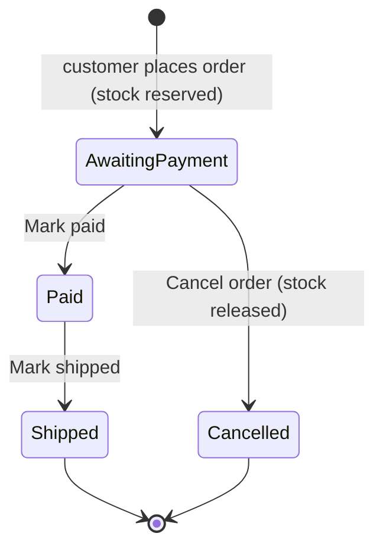

# Design: order handling (admin)

Feature: #24 · Task: #26 · Release 1 (walking skeleton) · Author: pro-designer

## 1. Purpose

The owner sees every order, checks the wallet for a matching on-chain payment, marks the order paid and later shipped, or cancels an unpaid order, which releases its reserved stock. Paid and shipped don't change stock. **No customer emails in R1:** the paid and shipped emails are R2 (#30). Every email part of this spec (email status lines, the "Email not sent" banner and list marker, "gets an email" dialog copy, the failed-email AC) is marked **R2 only (#30)** and is left out of the R1 wireframes and copy. English UI only, shop name probooks, Denmark only, prices like €12.50, flat shipping €3.00. No live customer order status in R1 (R3 #42).

Consistent with: admin login and import (#45, nav "Import · Orders · Log out", 7-day session), cart and checkout (#49, order number = payment reference, BTC amount locked and stored), ADR 0004 (PR #50): statuses `awaiting_payment`, `paid`, `shipped`, `cancelled`; order number `BH-` + 5 Crockford base32 characters (e.g. `BH-7K3Q9`); amount stored as satoshis; endpoints `POST /api/admin/orders/{order_number}/paid|ship|cancel`, other transitions return 409. List and detail payloads follow pro-architect's answers on #25 (section 10, D7–D11).

## 2. Status flow



R2 (#30) adds a customer email on Mark paid and Mark shipped; R1 sends none.

Not allowed in R1: cancel after paid, undo paid, undo shipped, ship without paid, reopen a cancelled order. The UI never offers these buttons; the server returns 409 if tried anyway (section 6).

Status labels and badges (text is always shown, colour is only extra):

| Status | Label | Badge | Next action |
|---|---|---|---|
| awaiting_payment | Awaiting payment | amber outline, ⏳ | Mark paid · Cancel order |
| paid | Paid | blue, ✓ | Mark shipped |
| shipped | Shipped | green, ✓✓ | none |
| cancelled | Cancelled | grey, ✕ | none |

## 3. Wireframes

### 3.1 Order list (`/admin/orders`)

```
Desktop
+--------------------------------------------------------------------------------+
| probooks · Admin                         Import | Orders          [Log out]    |
+--------------------------------------------------------------------------------+
| Orders                                                                         |
|                                                                                |
| Status: [ Awaiting payment (3) ] [ Paid (1) ] [ Shipped (12) ] [ Cancelled (2) ] [ All (18) ] |
|                                                                                |
| Find order  [ BH-7K3Q9 or customer name/email      ] [Find]                    |
|                                                                                |
| Order no.   Placed             Customer                 Total            Status            |
| ---------------------------------------------------------------------------------------- |
| BH-7K3Q9    20 Oct 2026, 00:41 Mette Hansen             €36.00           ⏳ Awaiting payment |
|                                mette@example.dk         0.00056250 BTC                     |
| BH-M2P4X    19 Oct 2026, 22:10 Jens Nygaard             €15.50           ✓ Paid            |
|                                jens@example.dk          0.00024220 BTC                     |
| BH-Q8R2N    19 Oct 2026, 18:03 Anne Holm                €21.00           ✓ Paid            |
|                                anne@example.dk          0.00032810 BTC                     |
| ...                                                                            |
|                                                             Showing 1–18 of 18 |
+--------------------------------------------------------------------------------+

Mobile (cards, one per order)
+------------------------------+
| Orders                       |
| Status [Awaiting payment ▾]  |
| [Find order ______] [Find]   |
|------------------------------|
| BH-7K3Q9   ⏳ Awaiting payment|
| Mette Hansen                 |
| €36.00 · 0.00056250 BTC      |
| 20 Oct 2026, 00:41         › |
|------------------------------|
```

- Default filter: **Awaiting payment** (the work queue). Filter is in the URL (`/admin/orders?status=paid`) so reload/back keep it. Counts per status in the filter buttons.
- Sort: newest first within every filter, one simple rule (D4).
- The whole row (and the order number as a link) opens the detail page. No status-changing buttons in the list in R1: every action happens on the detail page, where the full order is visible. This avoids mis-clicks in a dense table.
- "Find order" matches the order number exactly (case-insensitive, with or without `BH-`, ignoring spaces) or a substring of name/email. Needed to match a wallet note to an order.
- Pagination 25 per page server-side (D7). Range text under the list: "Showing {from}–{to} of {total}" (e.g. "Showing 26–50 of 60"), from `page`, `page_size` and `total`. [‹ Prev] / [Next ›] show only when there is more than one page (the wireframe has 18 orders, so no pager); Prev is disabled on the first page, Next on the last. With 0 results the empty state shows (section 4) and there is no range text and no pager.
- **R2 only (#30), not in R1 — failed-email marker:** when the current step's email (`paid_email_status` for Paid, `shipped_email_status` for Shipped) is `failed`, or `pending` for more than 5 minutes (3.4), the row shows "⚠ Email not sent" under the status (icon + text, warning style, never colour only). On mobile cards it is its own line under the status. Rows keep their normal sort position; the marker is the cue to open the order.
- Total shows EUR and BTC on two lines; BTC with 8 decimals, monospace, so amounts line up digit for digit with the wallet.

### 3.2 Order detail (`/admin/orders/{order_number}`)

```
Desktop
+--------------------------------------------------------------------------------+
| probooks · Admin                         Import | Orders          [Log out]    |
+--------------------------------------------------------------------------------+
| ‹ Back to orders                                                               |
|                                                                                |
| Order BH-7K3Q9                                    ⏳ Awaiting payment           |
| Placed 20 Oct 2026, 00:41                                                      |
|                                                                                |
| +---------------------------- Match the payment ----------------------------+ |
| | Payment reference   BH-7K3Q9                  [Copy reference]             | |
| | Amount due          0.00056250 BTC            [Copy amount]                | |
| |                     = €36.00 · rate 1 BTC = €64,000.00, locked 20 Oct 00:41| |
| | To address          bc1q xy2k gdyg jrsq tzq2 …(full, grouped by 4)         | |
| | Look for an incoming payment of at least this amount to this address,     | |
| | with the reference as a note if the wallet shows one.                     | |
| +---------------------------------------------------------------------------+ |
|                                                                                |
| Actions                                                                        |
| [ Mark paid ]   [ Cancel order ]                                               |
|                                                                                |
| Progress                                                                       |
| ● Placed          20 Oct 2026, 00:41   Stock reserved                         |
| ○ Paid            —                                                            |
| ○ Shipped         —                                                            |
|                                                                                |
| Items                                                                          |
| 2 × Book title — Author (ISBN 9788702…)                 €12.50   €25.00       |
| 1 × Another title — Author                               €8.00    €8.00       |
| Shipping (Denmark, flat rate)                                     €3.00       |
| Total                                                            €36.00       |
|                                                                                |
| Customer                                Deliver to                             |
| Mette Hansen                            Mette Hansen                           |
| mette@example.dk [Copy email]           c/o Jensen                             |
|                                         Nygårdsvej 41                          |
|                                         2100 København Ø, Denmark  [Copy address] |
+--------------------------------------------------------------------------------+
```

Mobile: one column in this order: heading + status, Match the payment, Actions (full-width buttons), Progress, Items, Customer, Deliver to.

Action area by status:

| Status | Actions shown | Note under actions |
|---|---|---|
| Awaiting payment | **Mark paid** (primary) · Cancel order (secondary, danger outline) | — |
| Paid | **Mark shipped** (primary) | "Paid orders can't be cancelled in Release 1." |
| Shipped | none | "This order is complete." |
| Cancelled | none | "This order was cancelled on {date}. Its stock was released." |

Progress shows a timestamp per step (`paid_at`, `shipped_at`, `cancelled_at`). For cancelled orders the list is Placed → Cancelled. R1 shows no email status in Progress.

**R2 only (#30):** Progress adds the email indicator (3.4) to Paid and Shipped, and the "Email not sent" banner (3.5) sits directly under the heading, above "Match the payment" (mobile: right after heading + status).

### 3.3 Confirmation dialogs

All three actions are irreversible in R1, so each gets a modal confirmation. R1 sends no customer email on any of them (R2 #30 adds emails on paid and shipped; the R2 dialog sentence is in section 6). Native-like `<dialog>`, same component for all three.

```
+-------------------------------------------------+
| Mark order BH-7K3Q9 as paid?                    |
|                                                 |
| Only do this when you have found the payment in |
| your wallet:                                    |
|   0.00056250 BTC  (€36.00)                      |
|                                                 |
| You can't undo this.                            |
|                                                 |
|              [ Go back ]   [ Mark paid ]        |
+-------------------------------------------------+

+-------------------------------------------------+
| Mark order BH-7K3Q9 as shipped?                 |
|                                                 |
| Ship to: Mette Hansen, Nygårdsvej 41,           |
| 2100 København Ø                                |
|                                                 |
| You can't undo this.                            |
|                                                 |
|              [ Go back ]   [ Mark shipped ]     |
+-------------------------------------------------+

+-------------------------------------------------+
| Cancel order BH-7K3Q9?                          |
|                                                 |
| The order is cancelled and its 3 books go back  |
| into stock. You can't undo this.                |
|                                                 |
| Only cancel if no payment has arrived.          |
|                                                 |
|          [ Keep order ]   [ Cancel order ]      |  <- danger style
+-------------------------------------------------+
```

- **Book count {n}** (cancel dialog and cancel success banner): the total number of copies on the order, the sum of all line quantities (2 × A + 1 × B = 3), because that is how much stock goes back. Not the number of titles. Singular "1 book", plural "{n} books".
- The confirm button repeats the verb (never "OK"/"Yes"). Focus starts on the safe button (Go back / Keep order). Esc and clicking outside = safe button.
- While the request runs, the confirm button reads "Marking paid …" / "Marking shipped …" / "Cancelling …", both buttons disabled, Esc ignored.
- On success: dialog closes, page re-renders with the new status, a success banner at the top ("Order BH-7K3Q9 marked paid.") and focus moves to that banner.
- On failure: dialog stays open with the error inside it (section 4), so the owner can retry or go back.

### 3.4 Email-sent indicator — R2 only (#30), not in R1

Not built or shown in R1: there are no customer emails in R1, so R1 has no indicator and no "emails not set up yet" state. Shown in Progress per step that emails the customer (Paid, Shipped), and in the list as a small line under the status for the current step. Driven by `paid_email_status` / `shipped_email_status` (`pending` | `sent` | `failed`) and `paid_email_sent_at` / `shipped_email_sent_at` (#25, D9). The status change commits first and the email is sent after it.

| API value | Text | Icon |
|---|---|---|
| step not reached (field null) | Customer email: not yet | ○ |
| `pending`, up to 5 minutes | Customer email: sending … | ⋯ |
| `sent` | Customer email sent {date}, {time} (from `*_email_sent_at`) | ✉ ✓ |
| `failed`, or `pending` for more than 5 minutes | Customer email not sent. The status change is saved. | ⚠ |

- A failed email never rolls back the status change: the order stays Paid/Shipped. The owner emails the customer by hand (3.5). No "Resend email" button (D1); the backend could support a resend later, but the UI doesn't offer one.
- After an action the detail reloads once; `pending` shows "sending …" and refreshes on the next load or window focus (no polling loop in R1).
- **Stale pending (ADR 0005):** an email still `pending` more than 5 minutes after the status change (`paid_at` / `shipped_at`) is treated as failed: the same "Customer email not sent" line, the same "Email not sent" banner (3.5) and the same list marker (3.1). Before 5 minutes, `pending` shows "sending …". The check runs on each load and window focus; no timer.

### 3.5 Email-not-sent notice — R2 only (#30), not in R1

When `paid_email_status` or `shipped_email_status` is `failed` (or `pending` for more than 5 minutes, 3.4), the order detail shows a warning banner directly under the heading, above "Match the payment".

- Title: **⚠ Email not sent**
- Body: "The {paid|shipped} email to {customer email} failed. Email the customer yourself." plus [Copy email] (accessible name "Copy customer email {email}").
- If both failed: one banner, "The paid and shipped emails to {email} failed. Email the customer yourself."
- Stays as long as the API reports `failed`; not dismissible (no resend in R1). A persistent notice, not a toast.
- Warning style: icon + bold title text + border ≥ 3:1, text ≥ 4.5:1; colour is never the only cue. `role="status"`.
- List rows show the matching "⚠ Email not sent" marker (3.1).

## 4. States

| State | What the owner sees |
|---|---|
| Loading list | Heading and filters render; table area shows "Loading orders …" (skeleton rows, `aria-busy="true"`). Filters stay usable. |
| Loading detail | "Loading order …"; no action buttons until loaded. |
| Empty, no orders at all | "No orders yet. Orders appear here when customers check out." |
| Empty filter | "No orders awaiting payment." / "No paid orders." / "No shipped orders." / "No cancelled orders." + [Show all orders] |
| No search match | "No order matches ‘{query}’." [Clear search] |
| Order not found (bad URL) | "Order {order_number} doesn't exist." [Back to orders] |
| List/detail load error | "We couldn't load the orders. Please try again." [Try again] |
| Action error (network/server) | In the dialog: "The change wasn't saved. Please try again." [Try again] — safe to repeat (section 5). |
| **R2 only (#30):** Email failed (`*_email_status = failed`, or `pending` > 5 min) | Detail: warning banner "Email not sent" under the heading with [Copy email] (3.5); Progress step shows "Customer email not sent. The status change is saved." List: "⚠ Email not sent" under the status. |
| Action success | Banner: "Order {no} marked paid." / "Order {no} marked shipped." / "Order {no} cancelled. 1 book is back in stock." or "… {n} books are back in stock." ({n} = sum of quantities, 3.3) |
| Range and pager | "Showing {from}–{to} of {total}" under the list; [‹ Prev] [Next ›] only when there is more than one page. With 0 results: the empty state only, no range text, no pager. |
| Session expired (any load or action) | Same as #45: redirect to login with "Your session has expired. Please log in again.", then back to the same order page. The API returns 401 and applies nothing (D11); the UI never retries automatically; after login the owner sees the current status and repeats it if still needed. Banner after return if an action was interrupted: "Your last change wasn't saved. Check the order and try again." |
| Not logged in | Redirect to login; no order data flashes. |

## 5. Edge cases

| Case | Handling |
|---|---|
| Double-click on Mark paid / confirm | The first click opens the dialog; inside it the confirm button disables on first click. The server only allows the transition from the expected status, so a second request returns 409 and is shown as "already done" (next row), never as a second change (R2: never a second email). |
| Changed in another tab or device | Server returns 409 with the current status. Dialog closes, page reloads the order, info banner: "This order was already {marked paid / marked shipped / cancelled} (at {time}). Nothing was changed." `{time}` comes from `status_changed_at`, status from `current_status` in the 409 `invalid_transition` body (D8). No error styling if the current status equals the requested one; warning styling if it differs (e.g. tried to mark paid, but it was cancelled). |
| Cancel after paid | Not offered (no button). If forced (stale tab), 409 → "Paid orders can't be cancelled. The order is {status}." No refund copy on screen in R1 (D2). |
| Mark shipped before paid | Not offered. Stale tab → 409, same pattern. |
| Paid less / more than due, or wrong reference | The shop doesn't check payments. The panel says "at least this amount". Owner decides; no partial-paid status in R1 (D5). |
| Customer paid without a note | Owner matches on amount (8 decimals are near-unique) and time; "Find order" helps. |
| Two orders with the same BTC amount | Possible but rare; list shows placed time to tell them apart. |
| Cancelled order later paid by the customer | Out of scope R1; owner refunds by hand outside the shop (D2). |
| Book deleted or hidden after the order | Line items show the stored title and price from the order, not the live book. |
| Very long names / addresses | Wrap; never truncate on the detail page. List truncates with ellipsis, full value in `title` and accessible name. |
| Many orders | Server-side pagination, 25 per page (D7). |
| Old unpaid orders | No auto-cancel in R1; stock stays reserved until the owner cancels (D6). |
| **R2 only (#30):** Email fails or stays pending > 5 min | Status stays saved; banner + list marker (3.5); owner emails by hand. |
| Stale list | List reloads on window focus and after every action; no live push in R1. |

## 6. UI copy

{n} in the cancel dialog and cancel success is the total number of copies (sum of line quantities), not the number of titles: "1 book" / "{n} books". Rows marked **R2 only (#30)** are not in R1.

| Key | English |
|---|---|
| Nav | Import · Orders · Log out |
| List heading | Orders |
| Filter label / options | Status: · Awaiting payment ({n}) · Paid ({n}) · Shipped ({n}) · Cancelled ({n}) · All ({n}) |
| Range and pager | Showing {from}–{to} of {total} · ‹ Prev · Next › (pager only with more than one page; neither with 0 results) |
| Search | Find order · Order number, name or email · Find · Clear search |
| Columns | Order no. · Placed · Customer · Total · Status |
| Statuses | Awaiting payment · Paid · Shipped · Cancelled |
| Detail heading | Order {no} · Placed {date}, {time} · ‹ Back to orders |
| Match panel | Match the payment · Payment reference · Amount due · = {eur} · rate 1 BTC = {rate}, locked {date} {time} · To address · Look for an incoming payment of at least this amount to this address, with the reference as a note if the wallet shows one. |
| Copy | Copy reference · Copy amount · Copy email · Copy address · Copied · Couldn't copy. Select the text and copy it yourself. |
| Actions | Actions · Mark paid · Mark shipped · Cancel order |
| Busy | Marking paid … · Marking shipped … · Cancelling … |
| Action notes | Paid orders can't be cancelled in Release 1. · This order is complete. · This order was cancelled on {date}. Its stock was released. |
| Progress | Progress · Placed · Paid · Shipped · Cancelled · Stock reserved · Stock released |
| Email indicator (**R2 only, #30**) | Customer email: not yet · Customer email: sending … · Customer email sent {date}, {time} · Customer email not sent. The status change is saved. |
| Email not sent notice (**R2 only, #30**) | Email not sent · The {paid\|shipped} email to {email} failed. Email the customer yourself. · The paid and shipped emails to {email} failed. Email the customer yourself. · Copy email |
| List email marker (**R2 only, #30**) | ⚠ Email not sent |
| Dialog paid | Mark order {no} as paid? · Only do this when you have found the payment in your wallet: · You can't undo this. · Go back · Mark paid |
| Dialog shipped | Mark order {no} as shipped? · Ship to: {address} · You can't undo this. · Go back · Mark shipped |
| Dialog email sentence (**R2 only, #30**) | Paid: {name} gets an email that the payment is confirmed. · Shipped: {name} gets an email that the order is on its way. (Goes before "You can't undo this.") |
| Dialog cancel | Cancel order {no}? · The order is cancelled and its 1 book goes back into stock. / The order is cancelled and its {n} books go back into stock. · You can't undo this. · Only cancel if no payment has arrived. · Keep order · Cancel order |
| Success | Order {no} marked paid. · Order {no} marked shipped. · Order {no} cancelled. 1 book is back in stock. · Order {no} cancelled. {n} books are back in stock. |
| Conflict | This order was already {marked paid / marked shipped / cancelled} (at {time}). Nothing was changed. · Paid orders can't be cancelled. The order is {status}. |
| Empty | No orders yet. Orders appear here when customers check out. · No orders awaiting payment. · No paid orders. · No shipped orders. · No cancelled orders. · Show all orders · No order matches ‘{query}’. |
| Errors | We couldn't load the orders. Please try again. · The change wasn't saved. Please try again. · Order {no} doesn't exist. · Try again |
| Session | Your session has expired. Please log in again. · Your last change wasn't saved. Check the order and try again. |
| Items | Shipping (Denmark, flat rate) · Total · Customer · Deliver to |

Formats (same as #49): `€36.00`, `€1,250.00`, `0.00056250 BTC` (8 decimals, from `amount_sats`, never recomputed), `1 BTC = €64,000.00`, dates `20 Oct 2026, 00:41` in 24-hour time, Europe/Copenhagen. Order number shown exactly as stored (`BH-7K3Q9`), monospace, never split.

## 7. React patterns (for pro-developer)

Reuse what #45/#49 already introduce; no new libraries.
- `AdminLayout` (nav, auth gate, session-expired redirect) wraps both pages.
- `StatusBadge({status})` — label + icon, one map used by list, detail, dialogs.
- `FilterTabs` — buttons with `aria-pressed`, synced to `?status=`.
- `ConfirmDialog({title, body, confirmLabel, busyLabel, danger, onConfirm})` — one component for all three actions.
- `CopyButton` and `Banner` (info/success/warning/error) from #49/#45.
- `Money` (EUR) and `BtcAmount` (sats → 8 decimals) formatters shared with checkout.
- **R2 only (#30):** `EmailIndicator({state, sentAt, changedAt})` (applies the 5-minute stale-pending rule, 3.4).
- `Pager({page, pageSize, total})`: range text, Prev/Next hidden with one page, nothing with 0 results.

## 8. Accessibility (WCAG 2.1 AA)

- `lang="en"`; page titles "Orders – Admin – probooks", "Order BH-7K3Q9 – Admin – probooks"; one `<h1>` per page.
- **List:** a real `<table>` with `<caption>` ("Orders, awaiting payment, 3 orders") and `<th scope="col">`; each row's order number is a link (the row click is an extra, not the only way). On mobile the cards are a list (`<ul>`) of links.
- **Filters:** a group (`role="group"`, label "Filter by status") of buttons with `aria-pressed`; count change announced via `aria-live="polite"` ("3 orders awaiting payment").
- **Status:** always text + icon; colour never the only cue; badges ≥ 4.5:1 text contrast, borders ≥ 3:1.
- **Dialogs:** `<dialog>` with `aria-modal="true"`, `aria-labelledby` (title) and `aria-describedby` (body); focus trapped, initial focus on the safe button, Esc closes (except while busy), focus returns to the triggering button or, after success, to the success banner. Danger button uses text, not just red.
- **R2 only (#30) — Email not sent notice:** `role="status"` region right after the `<h1>`; title as text ("Email not sent") plus ⚠ icon with `aria-hidden`, never colour only; not dismissible; the copy button inside has a specific name. The list marker is text, included in the row's accessible name.
- **Busy/results:** busy buttons keep their accessible name updated; success/info banners `role="status"`, errors `role="alert"`; loading regions `aria-busy`.
- **Amounts and address:** plain text in monospace ≥ 16 px; grouping of the address via CSS only, so screen readers and copy get the plain value. Copy buttons have specific names ("Copy payment reference BH-7K3Q9").
- **Progress:** an ordered list; each step reads e.g. "Paid, 20 Oct 2026, 00:52" (R2 appends the email state, e.g. ", customer email sent").
- **Range text:** plain text after the table; the pager is a `<nav aria-label="Pages">` with real buttons; disabled Prev/Next use `disabled`, not just styling.
- Keyboard: everything reachable with Tab, visible focus ring ≥ 3:1; targets ≥ 24×24 px (44 px on mobile); reflow at 320 px and 200 % zoom (the table becomes cards).
- No time limits other than the 7-day session (#45).

## 9. Acceptance criteria mapping (#24)

| Acceptance criterion | Spec sections |
|---|---|
| The admin order list shows each order's number, customer, total (EUR and BTC) and status. | 3.1 (incl. range text and pager), 2 (status labels), 4 (loading/empty/error, range), 6, 8 (table) |
| The owner can mark an order paid, and then shipped. | 2, 3.2 (action area), 3.3 (dialogs), 4 (success/error), 5 (double-click, other tab, ship before paid) |
| The owner can cancel an unpaid order, which releases its reserved stock. | 2, 3.2, 3.3 (cancel dialog; {n} = total copies, the sum of quantities, "1 book" / "{n} books"), 4 (success "{n} books are back in stock"), 5 (cancel after paid), 6 |
| **R2 only (#30), not an R1 criterion:** a failed paid/shipped email (or one still pending after 5 minutes) is visible so the owner can email by hand (pro-product-owner addition on #53) | 3.1 (list marker), 3.4 (incl. stale pending), 3.5, 4 (email failed), 6, 8 |
| Marking an order paid or shipped does not change stock. | 2 (only cancel releases stock), 3.2 Progress ("Stock reserved" only at Placed), 3.3 (paid/shipped dialogs mention no stock) |

Screenshots for `docs/features/order-handling/` (pro-qa): list per filter, detail per status, each dialog, conflict banner, empty state, mobile list, list with more than 25 orders (range and pager). R2 adds: email-not-sent banner and list marker.

## 10. Resolved decisions

No open questions remain.

Accepted by pro-product-owner on #53:
- **D1 Resend email (R2, #30):** no "Resend email" button in R1. If a paid/shipped email fails, the owner emails the customer by hand; the detail shows the "Email not sent" notice with [Copy email] and the list shows a marker (3.5).
- **D2 Refunds:** cancel after paid is not allowed (ADR 0004); no refund copy on screen in R1.
- **D3 Cancel email:** the customer is not emailed on cancel in R1.
- **D4 Default filter and sort:** Awaiting payment, newest first.
- **D5 Underpaid/overpaid:** no partial-paid status; the owner decides.
- **D6 Auto-cancel:** none in R1; stock stays reserved until the owner cancels.

Answered by pro-architect (#25):
- **D7 List API:** `GET /api/admin/orders?status=&q=&page=` returns `items`, `page`, `page_size` (25), `total` and `counts` per status; filtering, search and paging are server-side.
- **D8 409 body:** a disallowed change returns 409 `invalid_transition` with `current_status` and `status_changed_at`, used by the "already … (at {time})" banner (5).
- **D9 Email state (R2, #30):** `paid_email_status` / `shipped_email_status` = `pending` | `sent` | `failed`, with `paid_email_sent_at` / `shipped_email_sent_at`. The status commits first, the email is sent after, and a failure never rolls back. Mapping in 3.4. The backend could support a resend, but R1 has no resend button (D1).
- **D10 Detail payload:** includes `btc_address`, `rate_eur_per_btc`, `rate_source`, `rate_at` and `amount_sats`; BTC is shown from `amount_sats`, never recomputed.
- **D11 Session expiry:** 401 and nothing is applied; the UI sends the owner to login with no automatic retry (4).

Answers to pro-qa's #28 questions:
- **D12 Book count:** {n} in the cancel dialog and banner is the total number of copies (sum of quantities), since that is the stock that goes back. "1 book" / "{n} books" (3.3, 6).
- **D13 Range text:** "Showing {from}–{to} of {total}"; pager only with more than one page; with 0 results the empty state and no range text (3.1, 4, 6).
- **D14 Emails are R2 (#30):** every email part of this spec is R2 only; R1 shows no email status, banner, marker or email sentence. In R2, an email still `pending` 5 minutes after the status change shows as failed (ADR 0005, 3.4).

The customer payment page route is `/order/{token}`.

— pro-designer
